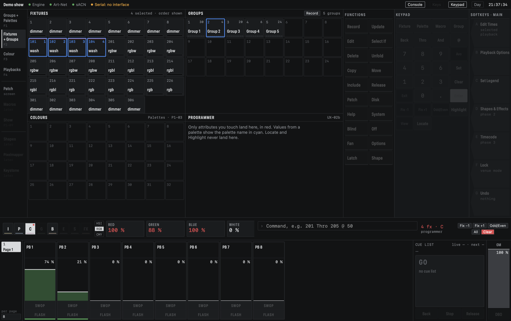
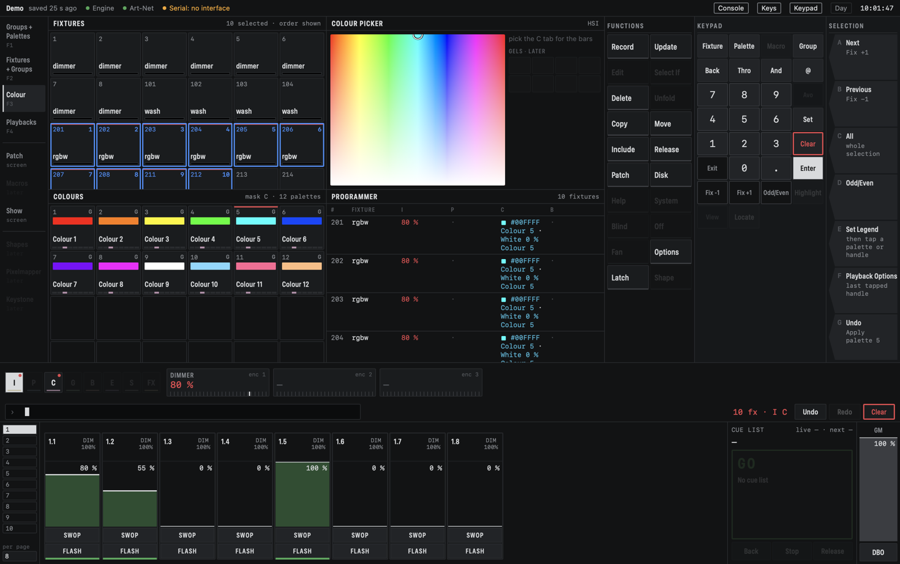

# CMDMX by Colourmotion

An open-source, native macOS lighting console built on the Avolites Titan way of working:
handles, a programmer, IPCGBES attribute groups, palettes, playbacks with fader modes. You
program the building blocks of a show once and run them as a cue list, as busking pages on a
MIDI controller, or both.

- **Show-proof by design.** The engine is a separate Rust process; if the app hangs or crashes,
  DMX keeps flowing and the app reconnects.
- **Native Mac app** in SwiftUI, built with the Command Line Tools only.
- **Out:** Art-Net, sACN and ENTTEC-Pro-compatible USB interfaces. **In:** any MIDI controller
  and any OSC app, mapped by Learn, with motor-fader and LED feedback; Mackie Control surfaces
  such as the Behringer BCF2000 work out of the box.
- **Fixtures:** the whole open QLC+ library (about 1800 fixtures), plus profiles typed from a
  plain channel list for fixtures nobody has a file for.

**Download:** [the latest DMG](https://github.com/Aottens/CMDMX/releases/latest)
(macOS 14+, Apple Silicon and Intel; all versions under
[Releases](https://github.com/Aottens/CMDMX/releases)). Releases are not notarised
yet: the first open needs right-click › Open, or *Open Anyway* in Privacy & Security on
macOS 15+.

The goal is a well-working general DMX console. Its first proof is a real Sunday service in the
owner's church run on it instead of Lightkey: moving-head washes, mixed RGBW / RGB+Lime / RGB
pars and theatre spots.



*The main screen, against a demo of the church rig: twelve colour palettes, ten pars in the
programmer (red) on palette 5, three faders up, and softkey G ready to undo "Apply palette 5".
Controls that are not built yet are greyed out.*



*The Colour workspace (F3): the selected pars in blue, the colour picker, and the Programmer
window with each fixture's values; cyan means the value comes from a palette.*

## Status

Phase 1, under active development, not yet trusted for a full service: the church still runs on Lightkey. CMDMX has
driven the real church rig through the Eurolite interface: fades comparable with Lightkey, replugging needs no
restart, and killing the app with `kill -9` mid-show dropped no DMX frame.

Next up, before the church runs on CMDMX at Christmas: the remote login check (RMB-04) and the rest of batch C
(SEE-07..10); then the church Mac (VS4-07) and the first service (VS4-03).
Phase 2 features already work; the open-hardware desk ([`hardware.md`](specs/modules/hardware.md)) runs beside it.
Progress is in [`STATE.md`](STATE.md), the plan in [`BACKLOG.md`](BACKLOG.md);
site and manual are at [aottens.github.io/CMDMX](https://aottens.github.io/CMDMX/).

## What works today

**Output**
- The engine runs at 40 Hz and sends every patched universe over Art-Net, sACN and USB (ENTTEC
  Pro protocol). A universe gets Art-Net and sACN by itself when its first fixture is patched;
  outputs are part of the show and can be added, changed and removed on the Output screen
  without the others dropping a frame.
- The Eurolite USB-DMX512 PRO MK2 drives real dimmers and LED pars (250000 baud, about 33 Hz).
  The port chosen on the Output screen survives a restart; unplugging and replugging needs no
  restart. `--no-artnet`, `--no-sacn` and `--no-serial` silence a protocol for one run.
- A node that goes wrong or recovers says so once on the message line, and the engine keeps its last
  200 messages, so a restarted app gets them back. A click on the line opens the *Messages* sheet with
  the history, a count shows the warnings you have not seen, and a click on a status dot opens its screen.
- While the engine runs the Mac does not go to idle sleep, with or without the app; if macOS
  refuses that, it is one warning and output carries on. In console mode the display stays awake too.
- After a stall (the Mac froze for a moment) output carries on at its normal rate, without a burst
  of the missed frames; a running fade is where it should be.
- If the app hangs or is killed, output runs on without a dropped frame; the restarted app shows
  the live faders, cue and programmer.
- If the engine dies, the app starts it again within seconds, also one it adopted after an app crash, and
  says plainly which show is back and that nothing is running, once it is so. An engine that keeps failing is
  tried less often, down to every 30 s, under one steady line, for as long as the app is open.
- **Lock** in the status bar, ⌘L or the softkey covers the console with a code keypad: DMX, running playbacks and autosave go on, every
  control and surface input stops, and quitting refuses until the unlock. A Flash or Swop held when the lock comes still
  ends when you let go. An operational control, not show-file protection.

**Patch and fixtures**
- A plain dimmer (`Generic` / `Dimmer`, 8-bit and 16-bit) is always in the library, also without the QLC+ set.
- Browse the library by manufacturer, pick a fixture, set mode, count, address and user number;
  clashes are refused. Move, renumber, rename, change mode and remove.
- Multi-select in the patch table: Shift/Cmd-click a range and move it back to back, renumber
  it, name it ("Par 1…6"), change its mode or remove it in one checked step.
- Removing a fixture or changing its mode also reaches effects, in cues, palettes and a cue running now, and
  a warning names each palette that holds something the new mode cannot do; Undo brings it all back.
- Park a fixture that is not hung: it keeps its place, groups, palettes and cues but is dark, cannot be selected and
  frees its channels; Unpark puts it back. A move or add onto used channels can park what it covers. In the app
  a parked row is greyed, "parked (was 1.37)", with Park and Unpark in the Selected panel; its tile shows `PARK`.
- A profile editor for channels, defaults, wheel slots and emitter auto-mix (CIE colour and
  output per emitter); profiles are saved into the show.
- GDTF files (the manufacturers' own format) convert into profiles in the engine, with cells
  from the fixture's geometry and each emitter's measured colour kept for later calibration;
  Import GDTF… in the Patch screen's Add panel saves one as a user profile and shows what each
  channel became.
- The church rig (56 fixtures from the owner's Lightkey patch) is patched by a one-off into the
  show *Kerk*.
- A phone remote behind a login set on the Remote screen: the engine serves a patch page on the network (port 7320),
  shown as an address and a QR code. On the phone: the fixtures in number order with search, a card to rename and
  readdress, and Previous / Next with Highlight following, so walking the rig is one tap per lamp. Park and Unpark
  on the card, and Park and move when a new address is taken.

**Programmer**
- Groups with legends: Record, Copy, Move, Delete and Set Legend on the Groups window, group masters
  follow a Move
- Select fixtures and groups, Fix ±1, odd/even, a Titan-style command line
  (`201 Thro 205 @ 50`), wheels, and the console keypad with command history. The command line
  already selects and sets single cells of multi-cell fixtures (`901 . 2 @ 50`, a colour on one
  cell over the fixture's colour), and cues, groups and palettes store those cell values
  (`901.2`). In the app a fixture button shows its cell count, Unfold lays the cells out as
  buttons right after it (`901.1`, `901.2`, …), and the Programmer and cue view list cell rows; Remove in the cue view takes a single cell's
  value out of a cue, and a cell value a cue list lets go fades back to its fixture (and one coming in fades from
  where the cell is).
- The Fixtures window: a named button shows its model under the name, Find matches number, name and model and Return
  selects the matches, and a selection made elsewhere (a group, the command line) brings its page and fixtures into
  view, with a dot on each page tab that holds a selected fixture.
- Fixture info: a right-click on a fixture button shows its type, address, groups, cues and palettes, and for each
  attribute why it has its value ("Dienst Q2 gives 100 %, tracked from an earlier cue, Master Zaal (3.8) scales it to
  0 %"), live while open; a tap on a row goes to that playback's page.
- Fan: the Fan key (lit while on) makes a wheel spread its change over the selection order as a
  Line, Mirror, Wings or Arrow curve, picked on the Fan softkeys and shown as `FAN <CURVE>` next
  to the wheels (Pan spread, a rainbow on Hue); a `fan` control action puts it on a button.
- Selection orders: the Order softkeys Reverse, Shuffle, Sort and Revert the selection; the
  Pattern softkeys lay Odd/Even, 1 in *n*, *n* in *m*, Blocks, Divide, Outside in or Inside out
  over it (an amber `GRID 1 IN 3 · 2/3` tag, Fix ±1 or Next steps through it); with Fan on its
  softkeys keep Next, All, Order and Pattern. Fan, effects, palette
  overlap, groups and cues follow; the Effect editor has Flip and Reverse/Shuffle/Sort. A cue's
  fixture order (who starts first on an overlap) is edited by tapping in Playback Options ▸ Times.
- Colour as one value per fixture: HSI, RGB, CMY or Kelvin wheels or a colour picker with
  CTO/CTB correction steps and a LEE gel book (search by number or name, `Lee 201` on the command
  line; the full LEE table ships once LEE gives permission). Extra emitters (White, Lime, …) are driven directly, or auto-mixed
  from the picked colour on types where the profile editor switches it on (a white on an RGBW par
  comes from its White LED).
- Locate, Highlight with lowlight, Off (per attribute group or one attribute), Rem Dim, and
  Clear with a choice of what LTP attributes do; `3` then Clear fades the programmer out over 3 s.

**Palettes**
- Colours, positions and beams recorded as on Titan (Global/Shared/Normal decided
  automatically), applied by tap or `Palette 3 Enter`, snapping or fading with fixture overlap.
- Cues and playbacks keep a reference, so changing a palette changes every place that uses it.

**Effects**
- The Shapes workspace (F5): select fixtures, tap a look (dimmer chase, circle, rainbow wave,
  …) and it runs at once around the current look; Size, Speed (BPM, Tap, BPM and Rate masters)
  and Spread on the screen and the encoders, a strip with a dot per fixture, wings, groups,
  blocks, direction and a colour list under More. The attribute tabs take the encoders back (I for
  the Dimmer), FX brings the effect wheels; an effect on dark fixtures says so.
- Effects record into cues (a timed Go carries a circle on or crossfades to the next effect, the
  fader scales them) and into palettes ("circle around the pulpit" on any selection).

**Playbacks, cue lists and chases**
- Record the programmer onto a handle; Replace/Merge/Update, Copy/Move/Delete, Titan paging
  locks, fader modes with fades and kill point, Flash/Swop/Latch, legends with icons, and DBO. Release fades
  intensity too, over the release time.
- Level bars never jump: a click on a strip, group master or the Grand Master changes nothing, a drag
  moves the level by the distance dragged.
- *New cue times* in Playback Options ▸ Settings: the delay, delay out, fade in, fade out and overlap that cues recorded
  from then on start with; an existing cue keeps its own.
- Delay out and fade out are *As In* until you type a time: empty, they follow the delay and fade in. A show saved
  before this keeps its output; a show saved with this release does not open on an older engine.
- A number the engine refuses goes back in its field half a second later.
- Cue lists with Go, Back, Go to cue, links, loop and tracking (Block, Cue Only, Solo), times per
  attribute group, a Go block, a Cue list window with a Times view that sets one time on many cues, View and ⋯ on
  each row, a one-cue playback shown on a tap, and a Cue view that follows every change, Undo included, where you take out a
  value, an effect or a whole fixture, or set a value Off and On again. Include loads a cue back into the programmer,
  and Update offers what it can store into, cues and palettes, on softkeys. Create List and Create Chase stay in
  Record, so a list is built by making a look and tapping its handle. The current cue reads large and
  green, the next small and grey. Playback Options shows only what applies to the playback type.
- Chases at a BPM with crossfade and direction, Tap tempo, and BPM and Rate masters that drive
  several chases at once.
- Group masters: a group on a fader masters its fixtures' intensity (Scale, HTP, Limit or Take
  Over), whatever puts them there. A master that holds its group down shows an amber GRP tag from any
  page, is listed in Active playbacks and is named when a show opens.

**Control**
- Any MIDI device: enable it, press Learn, click a fader or key on screen, move the hardware
  control. Motor faders and LEDs follow.
- Mackie Control surfaces (BCF2000, X-Touch, iCON): motor faders follow the page, Bank changes
  the page, Channel scrolls when a page has more faders than the surface.
- OSC, once switched on: a tablet sends to port 8000 and gets faders, page, cue and messages
  back on 9000; an existing layout's own addresses can be learned, so it needs no editing.
- A ready TouchOSC Mk1 layout for an iPad ([`touchosc/`](touchosc/), regenerated for any faders
  per page): faders with legends, page, Go/Back/Stop with cue texts, GM, DBO and the message line.
  `touchosc/serve.sh` puts it on the iPad over wifi, no TouchOSC Editor needed; checked on the
  church iPad mini.
- Elgato Stream Decks (Original, MK.2, Mini, XL, Neo, +, Pedal) driven by the engine itself, no
  Elgato app needed: a fresh deck gets playback keys, page and Go, each key drawn with the
  playback's legend, colour, level and state. In the Control screen you link keys by dragging a
  playback, Go, a page or the GM onto a key, by right-click or by Learn; a deck has its own pages.

**Show, undo and app**
- A delete says what it does before you confirm: how many cues on how many playbacks use a palette, a running playback's output ending, the live cue; under Patch's Confirm remove, where a fixture is used and what ends up empty.
- Esc goes one level up on every screen, whatever Keys says, and never changes the stage; opening a screen disarms.
- With Keys off, a Mac key or a click on the command line says how to turn Keys on. An armed function's own message goes when it disarms; a warning stays until the next command.
- An armed function or Record never does the normal action: every tap does what the table in the manual says or is refused with where it works, also a Flash or Swop; `Group 3 Enter` and `Palette 12 Enter` reach it from the command line, and Enter confirms a waiting Delete.
- The show is one readable JSON file in `~/Documents/CMDMX/Shows/`, autosaved within
  5 seconds of a change, crash-safe, and opened again at start.
- Undo and redo of every edit, 100 steps, while live playing (Go, faders, Flash) is never
  touched; ⌘Z and ⇧⌘Z.
- The app runs full screen with a status bar (engine, outputs, control devices, show), four
  workspaces, Patch, Output, Control and Show screens, and a dark and a day theme.
- App and engine check each other's protocol version and say plainly which versions differ.
- Installs from a versioned DMG that GitHub builds from a `v*` tag (universal; signed with a
  Developer ID and notarised by Apple once the signing secrets are set, ad hoc before that):
  the app starts its own engine and stops it on quit, so Lightkey can take the USB interface;
  quitting asks first in every mode, from ⌘Q, the menu or the close button, and writes the last
  changes to the show.
- A website ([`subprojects/website/`](subprojects/website/)) offers the latest DMG with its
  SHA-256 and the install steps; GitHub Pages rebuilds it after every release.
- A user manual on the website (`manual/`, mdBook with search and a print page): introduction,
  getting started, concepts, patching, programming, palettes, playbacks and cues, cue lists,
  running a show, taking over a show someone else programmed, control surfaces, shows and files, a reference and release notes, with
  screenshots from the app; it is the manual of the latest release, or a
  marked preview while that release has none. The app carries the manual of its own version: the
  **Help** key, *Help › CMDMX Manual* and ⌘? open it in the browser, without internet.

## Build and run

To use it, download `CMDMX-<version>.dmg` from the
[releases](https://github.com/Aottens/CMDMX/releases) and follow the install steps
there. To build it:

Requirements: macOS 14+, Rust (stable), Xcode Command Line Tools (`xcode-select --install`).

```sh
# once: fetch the QLC+ fixture library (pinned, Apache-2.0)
subprojects/engine/scripts/fetch-qlcplus.sh

# engine (keep it running); `-- --help` lists the flags, `-- --show-dir <folder>` keeps a test run away from your shows
cd subprojects/engine && cargo run -p cmdmx-daemon

# app, in a second terminal
cd subprojects/app && swift build && scripts/bundle-app.sh && open .build/CMDMX.app
```

Tests: `cargo test` in `subprojects/engine`.

## Repository

```
PROJECT.md ARCHITECTURE.md DECISIONS.md STATE.md BACKLOG.md IDEAS.md CLAUDE.md
specs/              PRD, ADRs, module specs with numbered acceptance criteria, UX sketch
subprojects/engine  Rust workspace: cmdmx-core, -protocols, -control, -daemon
subprojects/app     SwiftPM app (Command Line Tools only, no Xcode.app)
subprojects/hardware  Open-hardware desk (phase 10 track): PCB, firmware, CAD, BOM
tests/              scenario tests, manual and hardware checklists
touchosc/           TouchOSC Mk1 layout and its generator
scripts/            tracking check (runs in CI)
docs/screenshots/   README images
```

## How work happens

Every feature starts as a spec with numbered acceptance criteria, then come failing tests, then
code, and the owner reviews every pull request. Anything that touches hardware also gets a
checklist that the owner runs on the real gear. Details are in [`CLAUDE.md`](CLAUDE.md).

Licence: to be decided.
