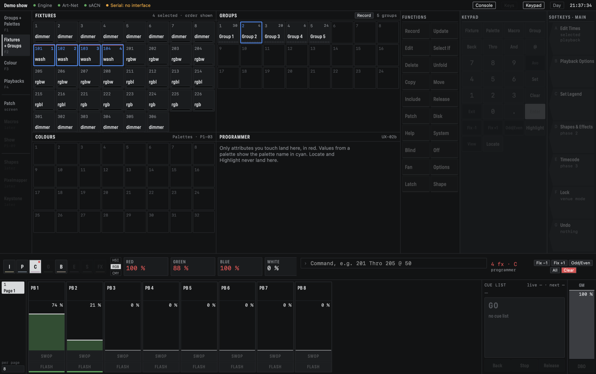

# CMDMX by Colourmotion

An open-source, native macOS lighting console built on the Avolites Titan way of working:
handles, a programmer, IPCGBES attribute groups, palettes, playbacks with fader modes. You
program the building blocks of a show once and run them as a cue list, as busking pages on a
MIDI controller, or both.

- **Show-proof by design.** The engine is a separate Rust process; if the app hangs or crashes,
  DMX keeps flowing and the app reconnects.
- **Native Mac app** in SwiftUI, built with the Command Line Tools only.
- **Out:** Art-Net, sACN and ENTTEC-Pro-compatible USB interfaces. **In:** any MIDI controller
  and any OSC app, mapped by Learn, with motor-fader and LED feedback; Mackie Control surfaces
  such as the Behringer BCF2000 work out of the box.
- **Fixtures:** the whole open QLC+ library (about 1800 fixtures), plus profiles typed from a
  plain channel list for fixtures nobody has a file for.

**Download:** [the latest DMG](https://github.com/Aottens/CMDMX/releases/latest)
(macOS 14+, Apple Silicon and Intel; all versions under
[Releases](https://github.com/Aottens/CMDMX/releases)). Not notarised yet: the first
open needs right-click › Open, or *Open Anyway* in Privacy & Security on macOS 15+.

The goal is a well-working general DMX console. Its first proof is a real Sunday service in the
owner's church run on it instead of Lightkey: moving-head washes, mixed RGBW / RGB+Lime / RGB
pars and theatre spots.



*The main screen, against a demo of the church rig: twelve colour palettes, ten pars in the
programmer (red) on palette 5, three faders up, and softkey G ready to undo "Apply palette 5".
Controls that are not built yet are greyed out.*


*The Colour workspace (F3): the selected pars in blue, the colour picker, and the Programmer
window with each fixture's values; cyan means the value comes from a palette.*

## Status

Phase 1, under active development, not yet trusted for a full service. On 2026-10-25 it drove
the real church rig through the Eurolite interface: fades comparable with Lightkey, replugging the
interface needs no restart, and killing the app with `kill -9` mid-show dropped no DMX frame.

Renamed to CMDMX by Colourmotion (VS8-01); a website with the latest DMG and the first manual
chapters is ready for GitHub Pages (VS8-03, 04). Next up: tag `v0.1.0`, install its DMG on the church
Mac (VS4-07), then the first service run (VS4-03). Progress is in [`STATE.md`](STATE.md), the plan in [`BACKLOG.md`](BACKLOG.md), the design in
[`specs/ux/main-screen.html`](specs/ux/main-screen.html).
Beside it runs the open-hardware desk (phase 3, [`hardware.md`](specs/modules/hardware.md)).

## What works today

**Output**
- The engine runs at 40 Hz and sends every patched universe over Art-Net, sACN and USB (ENTTEC
  Pro protocol). A universe gets Art-Net and sACN by itself when its first fixture is patched;
  outputs are part of the show and can be added, changed and removed on the Output screen
  without the others dropping a frame.
- The Eurolite USB-DMX512 PRO MK2 drives real dimmers and LED pars (250000 baud, about 33 Hz).
  The port chosen on the Output screen survives a restart; unplugging and replugging needs no
  restart. `--no-artnet`, `--no-sacn` and `--no-serial` silence a protocol for one run.
- If the app hangs or is killed, output runs on without a dropped frame; the restarted app shows
  the live faders, cue and programmer.

**Patch and fixtures**
- Browse the library by manufacturer, pick a fixture, set mode, count, address and user number;
  clashes are refused. Move, renumber, rename, change mode and remove.
- Multi-select in the patch table: Shift/Cmd-click a range and move it back to back, renumber
  it, name it ("Par 1…6"), change its mode or remove it in one checked step.
- A profile editor for channels, defaults and wheel slots; profiles are saved into the show.
- GDTF files (the manufacturers' own format) convert into profiles in the engine, with cells
  from the fixture's geometry and each emitter's measured colour kept for later calibration;
  Import GDTF… in the Patch screen's Add panel saves one as a user profile and shows what each
  channel became.
- The church rig (56 fixtures from the owner's Lightkey patch) is patched by a one-off into the
  show *Kerk*.

**Programmer**
- Select fixtures and groups, Fix ±1, odd/even, a Titan-style command line
  (`201 Thro 205 @ 50`), wheels, and the console keypad with command history. The command line
  already selects and sets single cells of multi-cell fixtures (`901 . 2 @ 50`, a colour on one
  cell over the fixture's colour), and cues, groups and palettes store those cell values
  (`901.2`). In the app a fixture button shows its cell count, Unfold lays the cells out as
  buttons right after it (`901.1`, `901.2`, …), and the Programmer and cue view list cell rows; Remove in the cue view takes a single cell's
  value out of a cue, and a cell value a cue list lets go fades back to its fixture (and one coming in fades from
  where the cell is).
- Fan: the Fan key (lit while on) makes a wheel spread its change over the selection order as a
  Line, Mirror, Wings or Arrow curve, picked on the Fan softkeys and shown as `FAN <CURVE>` next
  to the wheels (Pan spread, a rainbow on Hue); a `fan` control action puts it on a button.
- Colour as one value per fixture: HSI, RGB or CMY wheels or a colour picker, with extra
  emitters (White, Lime, …) driven directly.
- Locate, Highlight with lowlight, Off (per attribute group or one attribute), Rem Dim, and
  Clear with a choice of what LTP attributes do.

**Palettes**
- Colours, positions and beams recorded as on Titan (Global/Shared/Normal decided
  automatically), applied by tap or `Palette 3 Enter`, snapping or fading with fixture overlap.
- Cues and playbacks keep a reference, so changing a palette changes every place that uses it.

**Playbacks, cue lists and chases**
- Record the programmer onto a handle; Replace/Merge/Update, Copy/Move/Delete, Titan paging
  locks, fader modes with fades and kill point, Flash/Swop/Latch, legends with icons, and DBO.
- Cue lists with Go, Back, Go to cue, links, loop and tracking (Block, Cue Only, Solo), times per
  attribute group, a Go block, a Cue list window and a Cue view that follows every change, Undo
  included. The current cue reads large and
  green, the next small and grey. Playback Options shows only what applies to the playback type.
- Chases at a BPM with crossfade and direction, Tap tempo, and BPM and Rate masters that drive
  several chases at once.
- Group masters: a group on a fader masters its fixtures' intensity (Scale, HTP, Limit or Take
  Over), whatever puts them there.

**Control**
- Any MIDI device: enable it, press Learn, click a fader or key on screen, move the hardware
  control. Motor faders and LEDs follow.
- Mackie Control surfaces (BCF2000, X-Touch, iCON): motor faders follow the page, Bank changes
  the page, Channel scrolls when a page has more faders than the surface.
- OSC, once switched on: a tablet sends to port 8000 and gets faders, page, cue and messages
  back on 9000; an existing layout's own addresses can be learned, so it needs no editing.
- A ready TouchOSC Mk1 layout for an iPad ([`touchosc/`](touchosc/), regenerated for any faders
  per page): faders with legends, page, Go/Back/Stop with cue texts, GM, DBO and the message line.
  `touchosc/serve.sh` puts it on the iPad over wifi, no TouchOSC Editor needed; checked on the
  church iPad mini.
- Elgato Stream Decks (Original, MK.2, Mini, XL, Neo, +, Pedal) driven by the engine itself, no
  Elgato app needed: a fresh deck gets playback keys, page and Go, each key drawn with the
  playback's legend, colour, level and state. In the Control screen you link keys by dragging a
  playback, Go, a page or the GM onto a key, by right-click or by Learn; a deck has its own pages.

**Show, undo and app**
- The show is one readable JSON file in `~/Documents/CMDMX/Shows/`, autosaved within
  5 seconds of a change, crash-safe, and opened again at start.
- Undo and redo of every edit, 100 steps, while live playing (Go, faders, Flash) is never
  touched; ⌘Z and ⇧⌘Z.
- The app runs full screen with a status bar (engine, outputs, control devices, show), four
  workspaces, Patch, Output, Control and Show screens, and a dark and a day theme.
- App and engine check each other's protocol version and say plainly which versions differ.
- Installs from a versioned DMG that GitHub builds from a `v*` tag (universal, not notarised):
  the app starts its own engine and stops it on quit, so Lightkey can take the USB interface;
  quitting writes the last changes to the show first.
- A website ([`subprojects/website/`](subprojects/website/)) offers the latest DMG with its
  SHA-256 and the install steps; GitHub Pages rebuilds it after every release.
- A user manual on the website (`manual/`, mdBook with search and a print page): introduction,
  getting started, concepts, patching, programming, palettes, playbacks and cues, cue lists,
  running a show and release notes so far, with
  screenshots from the app; it is the manual of the latest release, or a
  marked preview while that release has none.

## Build and run

To use it, download `CMDMX-<version>.dmg` from the
[releases](https://github.com/Aottens/CMDMX/releases) and follow the install steps
there (the first open needs right-click › Open, or *Open Anyway* on macOS 15+). To build it:

Requirements: macOS 14+, Rust (stable), Xcode Command Line Tools (`xcode-select --install`).

```sh
# once: fetch the QLC+ fixture library (pinned, Apache-2.0)
subprojects/engine/scripts/fetch-qlcplus.sh

# engine (keep it running); `-- --help` lists the flags, `-- --show-dir <folder>` keeps a test run away from your shows
cd subprojects/engine && cargo run -p cmdmx-daemon

# app, in a second terminal
cd subprojects/app && swift build && scripts/bundle-app.sh && open .build/CMDMX.app
```

Tests: `cargo test` in `subprojects/engine`.

## Repository

```
PROJECT.md ARCHITECTURE.md DECISIONS.md STATE.md BACKLOG.md IDEAS.md CLAUDE.md
specs/              PRD, ADRs, module specs with numbered acceptance criteria, UX sketch
subprojects/engine  Rust workspace: cmdmx-core, -protocols, -control, -daemon
subprojects/app     SwiftPM app (Command Line Tools only, no Xcode.app)
subprojects/hardware  Open-hardware desk (phase 3 track): PCB, firmware, CAD, BOM
tests/              scenario tests, manual and hardware checklists
touchosc/           TouchOSC Mk1 layout and its generator
scripts/            tracking check (runs in CI)
docs/screenshots/   README images
```

## How work happens

Every feature starts as a spec with numbered acceptance criteria, then come failing tests, then
code, and the owner reviews every pull request. Anything that touches hardware also gets a
checklist that the owner runs on the real gear. Details are in [`CLAUDE.md`](CLAUDE.md).

Licence: to be decided.
