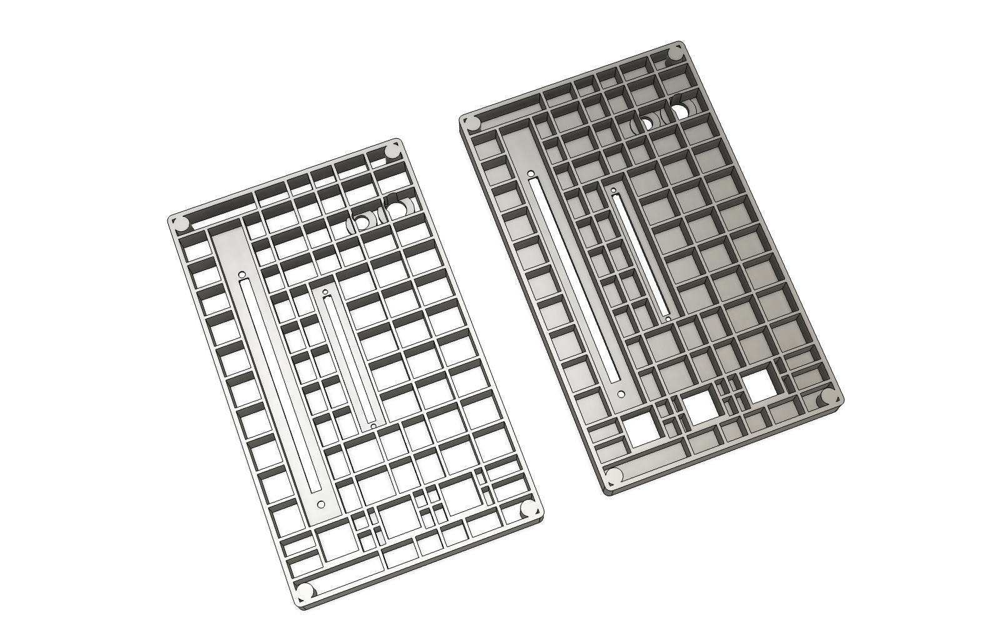

# Printed backing for the 1.5 mm test strip (HWB-11, HW-50, HW-53)

Two printed backings for `../cmdmx-acryl-proef-1.5mm.dxf`, the 120 x 200 mm engraving-plate strip. They answer one question
before the desk's top is engineered (HWB-07): **is a 1.5 mm plate on a printed frame stiff enough to be the desk's top?**
The plate is screwed onto either backing. The owner pushes on it, its keys and its faders, and compares. Gate 3:
[`tests/hardware/top-plate.md`](../../../../../tests/hardware/top-plate.md).

| File | What it is |
|---|---|
| `cmdmx-onderframe-ribben.stl`, `.step`, `.f3d` | **Ribben**: an open rib lattice. The plate lies on 1.6 mm ribs and spans the cells between them. 104 g PETG. |
| `cmdmx-onderframe-dicht.stl`, `.step`, `.f3d` | **Dicht**: the same lattice under a closed 2 mm skin, so the plate lies on a full surface. 138 g PETG. |
| `build/calc.py` | Plate and backing deflection under 20 N. Plain Python 3: `python3 build/calc.py` prints the table and `ok`. |
| `build/layout.py` | The geometry as boxes and cylinders, shared with the Fusion script. `python3 build/layout.py` checks every open cell against the deflection limit and prints `ok`. |
| `build/onderframe.py` | Fusion script (`cad/README.md`, needs only `CAD`) that builds both in a new document, checks them, writes the files above and closes the document unsaved. |

The two variants differ in one thing only, the skin, so the test compares exactly that. Coordinates are the
strip's (`acryl_strip.py`, `layout('1.5mm')`): x 0..120, y 0..200 with the fader tops at high y, z 0 = the plate's
underside, the backing down to z -13. The STEP and `.f3d` files are in those coordinates. Each STL is turned over to
lie plate face down on the bed, which mirrors y (y → 200 − y).

## Numbers: why ribs every 16.5 mm

`calc.py` treats each open cell as a plate simply supported on its ribs, with 20 N on a point in its middle
(Navier series, checked against Timoshenko's 0.0116 P a²/D for a square). Because the plate runs on over the ribs,
the real value lies between that and about half of it (clamped). Deflection in mm:

| Plate | cell 12 | **16.5** | 25 | 33 |
|---|---|---|---|---|
| 1.5 engraving plate, ABS core (E 2.0 GPa, the low reading) | 0.052 | **0.099** | 0.226 | 0.394 |
| 1.5 engraving plate, acrylic core (E 3.0 GPa) | 0.035 | 0.066 | 0.151 | 0.263 |
| 2 mm cast acrylic (E 3.2 GPa) | 0.014 | 0.026 | 0.060 | 0.104 |
| 1.5 aluminium, as on a bought desk | 0.001 | 0.003 | 0.006 | 0.011 |

- **Limit: 0.10 mm under 20 N** (a hard one-finger press, 2 kg on a kitchen scale), a push you cannot feel give.
  For the weakest reading of the plate that allows cells up to 16.6 mm. The lattice uses at most 16.5, half the
  desk's 33 mm fader pitch, so it carries over to the full panel. `layout.py` measures every open cell of the actual
  layout: the largest real cells are 16 x 15 (0.087 mm). The 16 x 16 key pockets come out at 0.093 mm, but there
  the plate has its own 14 mm hole and rests 1 mm from it.
- **Ribs both ways.** A long cell is governed by its short side but is softer than a square: 16.5 x 49.5 gives
  0.144 mm. So the ribs along x run through the ends of the fader channels, and no cell wraps round a channel.
- **For comparison:** the printed AMS panel (3 mm PETG skin, 33 mm lattice) gave 0.055 mm. The bought desk's
  aluminium is ten times stiffer again, so a printed top only feels like metal when it is supported almost everywhere.
  That is what *dicht* tests.
- **The backing as a beam.** On two supports 170 mm apart, with 20 N in the middle, *ribben* sags 0.28 mm and
  *dicht* 0.19 mm. The plate adds nothing here, because it is screwed only at its corners and slides on the ribs. On
  the desk, this part depends on how far apart the inner frame carries the under-panel (HWB-07), not on the plate.
- **Stress** in the plate under a fingertip is about 8 MPa, far below the 40 MPa of ABS or 70 MPa of acrylic.

## How it works

- **Plate on the backing (HW-50).** Four M3 button heads go through the plate's 3.2 holes into heat-set inserts in
  Ø 8 bosses at the corners. Nothing is glued. The backing's top face is one flat plane (the bed side of the print),
  so the plate lies flat on every rib, rail and pad.
- **Keys.** MX switches clip into the plate itself. Under each one, the backing has a 16 x 16 pocket through its full
  depth, 1 mm larger all round than the 14 mm hole. That leaves room for the switch body, its clips and its pins, and
  the wiring can reach the pins from below. A 1.6 mm frame round each pocket carries the plate right next to the hole.
- **Faders (mounted to the backing).** Each fader sits in a channel under a 2.7 mm rail, with its top face against the
  rail. Its screws come down through the rail into the fader's tapped holes. The heads sit in Ø 6.4 / Ø 4.8 x 1.75
  counterbores in the rail's top face, so the plate hides them. A push on the knob goes through the fader into the
  rail and its channel walls, not into the plate. The lever opening in the backing is 5.0 (PSM) or 4.0 (PTA) wide
  and 1 mm longer than the plate's slot at each end, so only the plate's edge shows.
  - PSM: M3 tapped 120 apart (datasheet), screws at y 37 and 157; the keep-out channel 16 x 154 is the one proven on
    the HWB-01 test box (`paneel-print/build/desk_build_60.py`).
  - PTA6043: M2 tapped 71 apart, screws at y 59.5 and 130.5; channel 12 x 78.
  - **Lever height.** The rail and the plate put the fader top 4.2 mm under the plate's face. That leaves 8.2 − 4.2 =
    **4.0 mm** of the PSM's lever above the plate (5.7 mm on the printed panel), and 5.8 or 10.8 mm of the PTA's
    10 or 15 mm lever. The test checks that the knobs still clear the plate.
- **Encoder holes** (7.2 and 10.2) get a 2.7 mm pad with a hole 0.4 mm larger. No encoder is mounted on this strip.

## Parts

| Part | For the strip | Where |
|---|---|---|
| Heat-set inserts M3 x 5.7 (hole Ø 4.0; the holes here are 8 deep) | 4 per backing, 8 for both | Ruthex (ships from Germany, VAT included, no import) |
| ISO 7380 button head M3 x 8, black | 4 (plate) | Any EU fastener shop, e.g. schraubenking.de (Germany) |
| ISO 7380 button head M3 x 4 | 2 (PSM) | Same shop. The head must sit no higher than 1.65 mm. |
| ISO 7380 M2 x 3, or ISO 14583 M2 x 3 pan head | 2 (PTA) | Same shop. The head must sit no higher than 1.65 mm. |
| Bourns PSM01 100 mm and PTA6043 60 mm faders, three MX switches with caps | from the HWB-01 parts | on the desk |

Turn each fader screw in by hand first. It must stop on its head, not on the end of the thread, because the fader's
datasheets give no thread depth. Under its head, M3 x 4 reaches 3.05 mm into the PSM and M2 x 3 reaches 1.7 mm into the PTA.

## Print (Bambu, 256 x 256 bed)

- **PETG**, the desk's material, so the test shows how the real panel will feel. PLA is stiffer (E about 3.5 GPa) and
  would flatter the result.
- **Plate face down** (as the STL lies), no supports: every feature rises straight up from the bed. 0.2 mm layers, a
  0.4 mm nozzle.
- 4 wall loops, so each 1.6 mm rib is solid wall. Bottom shell 3.0 mm (15 layers), so the 2.7 mm rails, the pads and
  the skin print solid. Infill 15 %; it only reaches the bosses.
- Elephant-foot compensation 0.15 mm. The bed face is the face the plate lies on, and a flared first layer would
  shrink the counterbores and pockets.
- The bed face must be flat: smooth or textured PEI both work. Use no brim.

## Assembly

1. Press the four inserts in from the plate face with the iron at about 230 °C (PETG). Stop each one flush, or up to
   0.1 mm below. Scrape off any raised rim, then check with a steel ruler that the plate face does not rock.
2. Screw the faders in from the plate face (PSM: M3 x 4, PTA: M2 x 3), with their tops against the rails.
3. Clip the three MX switches into the plate, which is the strip's own MX test. Then lay the plate on the backing
   with the switch bodies dropping into their pockets, and screw it down with the four M3 x 8 heads. Tighten them only
   snug, because the plate is plastic.
4. Fit the fader knobs and keycaps.

What this backing does not test: encoders (holes only), the stiffness of the desk's whole under-panel between the
frame's supports (HWB-07), creep over months, and heat.

Licence: CERN-OHL-S v2 (HW-55).
