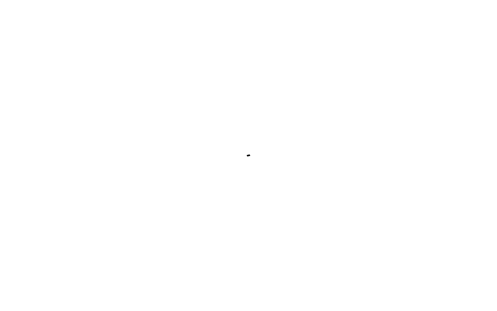

# Screen flap (HWB-10: HW-53, 54, 56, 57, 58)

The desk's screen flap around the Waveshare 15.6" HDMI LCD (H), with a printed test base, so the flap can be built
and tested before the body exists. Gate 3: `tests/hardware/flap.md`.

| File | What it is |
|---|---|
| `cmdmx-klep.f3d`, `.step` | The flap in its own frame: X across (0..570), Y from the hinge axis (0..250), Z from the underside (0) to the face (24). |
| `cmdmx-klep-strut.f3d`, `.step` | Strut arms, foot rod (desk coordinates, flap at 25°). |
| `cmdmx-klep-testvoet.f3d`, `.step` | The test base: the deck from y 320 to 551 with the hinge and the sawtooth grooves (desk coordinates). |
| `cmdmx-klep-*.stl`, `cmdmx-klep-voet-*.stl` | Every printed part, one file each; each fits a 256 x 256 x 256 mm bed (HW-58). |
| `build/klep.py` | Fusion script that builds all of it. It checks every part against the real screen, the strut against the base at 0, 15, 25, 35 and 45°, and the plug envelope, and asserts thickness, flushness and bed size. |
| `build/calc.py` | Strut geometry and loads, plain Python 3: `python3 build/calc.py` prints the table and asserts it. |
| `build/export.py`, `build/view.py` | Writes the files above, and sets the cameras for the renders. |

Desk coordinates: the hinge axis runs along x at (y 345, z 13), and the deck face is z 13 (as in `console/ontwerp/scripts/sb.py`).

## How it works

- **Face (HW-54, HW-58).** The flap has a walnut frame all round: sides 12 x 24 x 250, top and bottom bars
  570 x 12.3 x 24 (owner, 2026-11-15). Between them two printed side blocks carry the face beside the glass. The glass
  fills the middle, so the only print joins are hidden behind the glass and the walnut. The glass sits 0.38 mm under
  the face. On its left and right edges a 0.38 mm lip (the blocks' first two layers, printed face down) overlaps the
  black glass border by 1.5 mm. That lip is what holds the glass forward, since nothing else can do that without glue.
  Against the walnut, the top and bottom edges are flush with a 0.3 mm gap.
- **Glass clamp (HW-54).** From behind, four printed clamp strips press the glass border forward against the lip, and
  so does an aluminium 15 x 5 bar along the top edge. Each presses through 1 mm silicone foam, squeezed to 0.72 mm.
  The lower strips' arms reach the bottom corners. The middle of the bottom edge is left free, because the panel's
  flex cable runs there. Nothing is glued: take off the covers, undo the ten strip screws and the two keepers, and the module
  comes out the back.
- **Back cover (HW-57).** Cover A (78..330) lies over the driver board, with vents under it and 2 mm thin under the
  plugs. Cover B covers the rest. Each cover has a tongue in a groove of the walnut bottom bar, and is screwed at the
  top into the walnut and at the side into a block. The cable lid on the left block is separate.
- **Hinge.** A stainless piano hinge, 25 mm wide and 1.0 mm thick, cut to 508 mm (X 58..566). Its leaves are let
  1 mm into the walnut bottom bar and into the base, and the knuckle sits in a cove on the axis.
- **Strut and rack (HW-56).** Each side block takes a 6 mm stainless pivot pin, 115 mm along the flap and 9 mm
  inside it. On the pin an aluminium arm of 15 x 5 swings, 95 mm between centres, on an iglidur sleeve. An 8 mm
  stainless foot rod joins the two arms. The rod drops into four sawtooth grooves sunk 5 mm into the deck, with the
  steep face behind it, so a push on the screen only presses it harder into its step. The grooves sit at y 454.0
  (45°), 493.2 (35°), 520.8 (25°) and 540.2 (15°). Folded, the arms lie in pockets in the blocks and the rod in a
  channel of the covers, and the flap lies flat on the deck. The pivot moved 9 mm into the flap and the grooves went
  below the deck face, so the strut is 95 mm, not the massing's 85.
- **Loads.** The flap weighs 2.2 kg (module 1.0 kg), centre of gravity 125 mm from the hinge. With the HW-56 push
  (20 N at the top centre, square to the face), the strut carries 94 N at 15°, which is the worst case, and the rack
  takes 85 N toward the back. At 25° it is 69 N, at 35° 61 N, at 45° 66 N. The parts are sized for the 120 N of
  the brief.
- **Cables (HW-57).** HDMI, micro-USB (touch) and 12 V (3.5 x 1.35 mm DC) leave the driver board's left end into
  the left block. A printed clamp grips them under the cable lid. They drop through a notch in the walnut into a
  6.5 mm channel that runs 40 mm along the hinge axis (X 14..54). Folding turns them by 45° along that length
  instead of bending them at the hinge. They leave the base through a slot on the axis, and a second clamp under
  the base holds them.

## Parts to buy (pro grade; ship-from and EU route named)

| Part | Spec | Source |
|---|---|---|
| Piano hinge | Pinet stainless steel, barrel pin, 1020 x 25 x 1.0 mm; cut 508 mm (one bar gives two). | RS Components Netherlands, RS 328-9666 (Pinet 42-2-4060, made in France). Ships from RS's EU warehouse: delivered (DDP), Dutch VAT on the invoice, no import duty within the EU. Check the hole pitch on arrival. If it misses the walnut, drill 3.0 mm countersunk holes at 50 mm. |
| Walnut | American black walnut, planed: 2 x 250 x 24 x 12, 2 x 570 x 24 x 12.3. Rebates 5 x 3 on the inner back edge of the sides and the top bar. A 3 x 2.4 groove (Z 3.3..5.7) along the inner face of the bottom bar from X 95.3 to 474.7. The 1 mm hinge mortise, the R 2.4 knuckle cove, the R 6.5 cable channel and the notch at X 40..54, all as in the STEP. Corners: butt joints, two 6 x 30 beech dowels and PVA each (the frame is glued; the glass never is). | The same timber source as the desk's frame (HWB-07). |
| Clamp bar | Aluminium flat bar EN AW-6060, 15 x 5, 396 mm, no holes. | Any EU metal stockist that cuts to length (e.g. a German online cut-to-size shop: ships from Germany, delivered, VAT incl.). |
| Strut arms | 2 x aluminium flat bar 15 x 5, 110 mm, ends rounded R 7.5, two Ø 8.0 holes 95.0 mm apart. An M4 grub screw (DIN 916, A2) through each arm's foot end onto a flat on the rod. | As above. |
| Pivot pins | 2 x dowel pin ISO 2338 6 m6 x 45, stainless A1; a printed hole is reamed to 6.0 and the pin is pressed in. Retained by M3 x 6 with a DIN 9021 washer. | Any EU fastener shop. |
| Arm sleeves | 2 x igus iglidur G flange bearing GFM-0608-05 (6 bore, 8 outer, 5 long: the arm's thickness), pressed into the arms' pivot holes. | RS Components Netherlands, RS 272-4546, in the same order as the hinge (EU warehouse, DDP, Dutch VAT, no import duty); or igus GmbH directly (ships from Cologne, DE). |
| Foot rod | Stainless 1.4301 round bar Ø 8 h9, 450 mm, with two flats for the grub screws. | As the flat bar. |
| Inserts and screws | Heat-set inserts M3 x 4 (hole 4.0, 34 pcs); ISO 14583 A2 Torx pan head M3 x 8 (30) and M3 x 10 (12), so a T10 screwdriver does the whole swap; stainless wood screws 3.0 x 16 pan head (15) and 3.0 x 12 countersunk for the hinge. | Ruthex inserts (ships from Germany, VAT incl.); screws from any EU fastener shop. |
| Foam | Closed-cell silicone or EPDM sponge, 1.0 mm, 10 mm strip, adhesive on one side: it sticks to the clamp, never to the glass. About 1.2 m. | Any EU rubber supplier. |
| Cables | Slim HDMI (OD ≤ 4.5 mm, overmould ≤ 21 x 11 mm), micro-USB B to A, 12 V DC 3.5 x 1.35 mm, each about 0.6 m. | Buy with the screen. |

Print in anthracite PETG or ASA: 4 walls, 25 % gyroid, 0.2 mm first layer then 0.18 mm, so the lip is two layers.
Print the blocks face down on a textured plate. The covers, lid, strips and keepers lie flat. The base pieces print
top up.

## Rebuild

1. A new Fusion design in direct modelling (no history), with the Waveshare STEP imported at the root as is (the
   screen's file is Waveshare's and stays out of the repository).
2. `klep.py` with `ARGS` = the angle, through the wrapper in `../README.md`. Its first run copies the screen into a
   flat component `M scherm`: moving the imported assembly misplaces its nested driver board.
3. Run it at 25, then `export.py`. Renders: `view.py` with `ARGS = (camera, hidden prefixes)`.

Licence: CERN-OHL-S v2 (HW-55).
