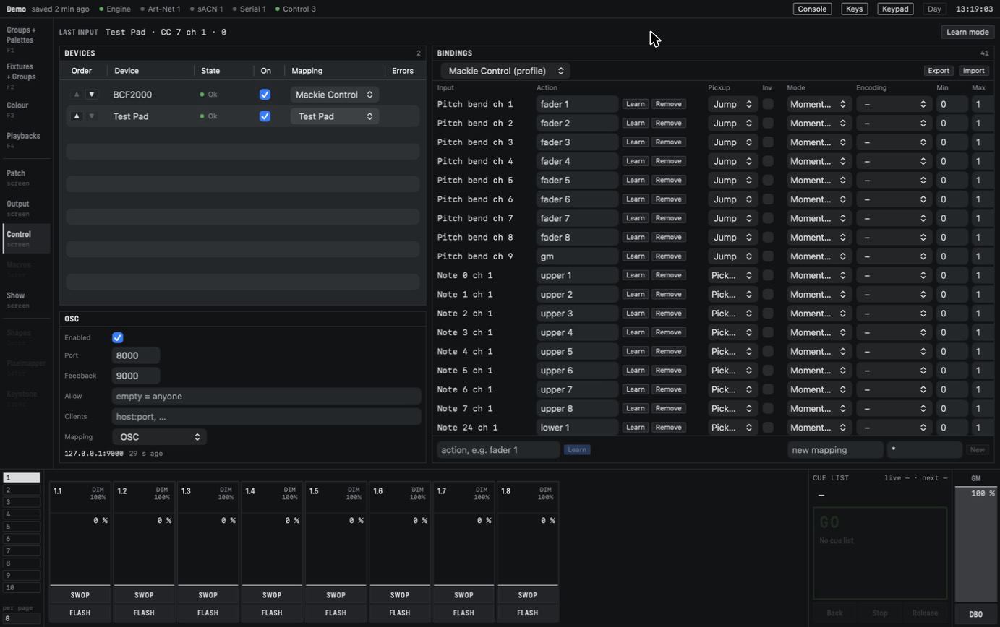

# Control surfaces

You can play CMDMX from hardware as well as from the screen: a MIDI controller, a motor-fader
surface in Mackie Control mode, a tablet running an OSC app, or an Elgato Stream Deck. A hardware
control does exactly what the screen control it is bound to does. Undo, refusals and messages are
the same, so a fader on a MIDI box is just another hand on the same fader.

## The Control screen

Open **Control** in the rail. The screen has three parts:

- **Devices**: every MIDI device and Stream Deck the engine has seen, with its state (**Ok**,
  **Missing** when it was seen before but is not plugged in now, **Disabled**), an **On** tick box,
  the mapping it uses and a count of messages it sent that could not be read.
- **OSC**: the settings for OSC over the network (see [OSC](#osc)).
- **Bindings**: the bindings of the mapping chosen at the top of the panel.

**LAST INPUT** at the top shows the last thing any enabled device sent, such as
`Test Pad · CC 7 ch 1 · 64`. Use it to see whether a device is talking at all.

*Two devices are enabled: the BCF2000 uses the Mackie Control profile, shown on the right, and the
pad its own mapping. OSC is on and has heard one client.*

A device you plug in for the first time is listed **Disabled** and does nothing. Tick **On** to use
it. It then gets the mapping made for it when there is one (a Mackie Control surface gets the
**Mackie Control** profile), or an empty mapping you fill by Learn. CMDMX remembers this per
device name, so the next time it is plugged in it works straight away.

When a device is unplugged it goes **Missing** with one warning, and keeps its mapping. Plug it in
again and it is back within two seconds, with its motor faders and lights up to date.

The **Control** dot in the status bar shows the worst state of the enabled devices and OSC. It is
amber when something is missing or busy; hover over it to see which.

## Mappings

A mapping is a named list of bindings, each one input on a device bound to one action. The
mapping list at the top of the Bindings panel holds:

- **Profiles**, marked `(profile)`, which come with the app. They cannot be changed. Editing a
  binding in one saves your own copy, which then takes its place.
- **Your mappings**, made by Learn or with **New**. **New** asks for a name and a device pattern:
  the name of the device, or a pattern with `*` (a `*` alone matches any device).

Mappings belong to the Mac, not to the show: opening another show keeps them. **Export** saves the
mapping shown as a `.json` file and **Import** reads one back, so you can take your mappings to
another Mac. Importing a mapping with a name that already exists asks before replacing it.
**Delete** asks for a second click.

## Learn

Learn binds the next control you move to an action. There are two ways to start it.

From the Bindings panel:

1. Type an action at the bottom of the panel, for example `fader 1` (see [Actions](#actions)).
2. Click **Learn**.
3. Move the control on the device. The message zone says, for example,
   `Learned: Test Pad CC 7 ch 1 → fader 1`, and the binding appears in the table.

From the main screen, which is quicker for many controls:

1. On the Control screen, click **Learn mode**. The status bar shows **LEARN**.
2. Go to the main screen and click the control you want to bind: a fader, a handle button, a key
   in the Go block, a page button, the GM or a programmer key. It does not act; the message zone
   says `Move a control for fader 3 … (Esc cancels)`.
3. Move the hardware control. CMDMX learns it and stays in Learn mode, so you can click the next
   control on the screen.
4. Press Esc, or click **LEARN** in the status bar, to stop.

A few rules make Learn safe to use:

- A fader or knob has to move a few steps before it is learned, so a control that jitters does not
  get bound by accident. A button is learned on the first press.
- One input does one action in a mapping. Learning an input that is already bound replaces the old
  binding and says what it was, for example `CC 7 was fader 2`. One action may have several inputs.
- Learn guesses what the input is (a button, a fader, a 14-bit fader, an endless encoder) and
  sets the options to match. You can change them in the table.
- **Learn** on a row of the table arms Learn for that row's action, to bind one more control to
  it. The row itself stays; remove it if you no longer want it.

## Binding options

Each row of the Bindings table can be edited in place. Type in a field and press Return; a value
the engine does not accept is refused with a message and the field goes back.

- **Action**: what the input does. **Remove** deletes the row after a second click.
- **Pickup** or **Jump**, for faders without a motor. With **Pickup**, a fader that is not where
  the level is does nothing until you move it through the level (or within 2 % of it); then it
  follows. This stops the level jumping after a page change or when someone moved it on the screen.
  With **Jump**, every move sets the level at once. Motor faders always follow the level and never
  need pickup.
- **Inv**: turns the control around (up is down).
- **Mode**: **Momentary** passes press and release on as they are. **Toggle** turns each press into
  on, then off, which is useful for DBO or a Flash button you want to latch.
- **Encoding**: for endless encoders, the way the device counts steps (**Sign magnitude**,
  **Two's complement** or **Binary offset**). If a knob turns the wrong way or jumps, try another.
- **Min** and **Max**: the part of the input's travel that is used. Values outside are clamped.
- **FB**: send feedback back to the control (a motor fader's position, an LED, a value on a
  tablet). On by default.
- **On** and **Off**: the values sent to light or dim an LED (127 and 0 by default). On pad
  controllers the value often picks the colour.
- **Page**: the deck page of a Stream Deck key (see [Stream Deck](#stream-deck)).

When a control's kind does not match its action, CMDMX converts: a fader on a button action
presses above half way and releases below it, and a button on a fader action sends full while held
and zero on release, which makes a quick bump.

## Actions

An action is a short text. These are the actions you can bind:

| Action | What it does |
| --- | --- |
| `fader 3` | the fader of slot 3 on the current page |
| `fader 2.3` | the fader of slot 3 on page 2, whatever page is shown |
| `playback 12 level` | the level of playback 12, wherever it is |
| `upper 3`, `lower 3` | the upper or lower button of slot 3 |
| `go`, `back`, `stop`, `release`, `tap` | on the connected cue list; `go 3` acts on slot 3, `go playback 12` on playback 12 |
| `page next`, `page prev`, `page 4` | the page |
| `gm` | the Grand Master |
| `dbo` | DBO while held (use **Toggle** mode to latch it) |
| `key clear`, `key locate`, `key highlight`, `key rem_dim`, `key undo`, `key redo`, `key all`, `key step_next`, `key step_prev` | the programmer keys |
| `keypad 1`, `keypad @`, `keypad Thro`, `keypad Enter`, … | a key of the on-screen keypad, into the command line |
| `wheel 2` | the second wheel of the attribute group that is open |
| `attribute_group C` | opens an attribute group (`I P C G B E S FX`) |
| `fan`, `fan line`, `fan mirror`, `fan wings`, `fan arrow`, `fan off` | Fan on and off, or with a curve |
| `group 3`, `palette 12` | selects the group, or applies the palette |
| `channel next`, `channel prev` | moves the fader window of a Mackie Control surface |
| `deck page next`, `deck page prev`, `deck page 2` | the page of the Stream Deck that sent it |

An action that is not on this list is refused, for example `unknown action "fader x"`.

Actions that follow the page (`fader 3`, `upper 3`) are the usual choice: the surface plays
whatever page you are on, and motor faders and lights follow when you change page. An empty slot
sends its fader to zero and its lights off.

## Mackie Control surfaces

A surface in Mackie Control mode, such as the Behringer BCF2000 or an X-Touch, gets the
**Mackie Control** profile when you enable it. On the BCF2000, choose the Mackie Control preset
when you switch it on (see its own manual). The profile binds:

- faders 1 to 8 to the slots of the current page, with the motors following the levels; the
  master fader to the GM;
- the top button row to the upper buttons and the **SELECT** row to the lower buttons;
- the encoders to the wheels, with the LED ring showing the wheel's value, and a push on the first
  encoder to the next fixture in the selection;
- **Bank ◀ ▶** to the previous and next page, and **Channel ◀ ▶** to the fader window;
- the transport keys **Play**, **Stop** and **Rewind** to Go, Stop and Back.

While you hold a motor fader it does not fight your hand. When you let go it settles where the
engine has the level, so a move that was refused springs back.

**The fader window.** A surface with 8 faders shows 8 slots at a time, starting at slot 1. With
more faders per page than the surface has, **Channel ▶** shows the next slots; faders past the end
of the page go to zero and do nothing. A page change always starts at slot 1 again. An extender
adds 8 faders: the units count up in the order of the device table, which you change with the
**▲ ▼** arrows in the **Order** column.

The X-Touch and iCON names are in the profile but have not been tested with it yet. Other MIDI
controllers are set up by Learn.

## OSC

OSC lets a tablet or another program control CMDMX over the network. It is off until you turn it
on in the **OSC** panel of the Control screen:

- **Enabled**: on or off.
- **Port**: where CMDMX listens, 8000 by default, on every network interface of the Mac.
- **Feedback**: the port CMDMX sends values back to, 9000 by default.
- **Allow**: leave it empty to accept any sender, or list IP addresses or subnets to accept only
  those.
- **Clients**: extra `host:port` addresses that always get feedback.
- **Mapping**: the mapping for addresses you learn (see below).

Below the settings, the panel lists the clients it has heard and how long ago. Every sender heard
in the last ten minutes gets feedback on its own IP address at the feedback port. If the port
cannot be opened (another program has it), the panel shows the error in amber and the console
keeps running.

CMDMX understands its own addresses under `/cmdmx` out of the box, for faders, buttons, Go, pages,
the GM, DBO, the keys, the keypad and the wheels. They are listed in the
[Reference](reference.md#osc-addresses).

You can also use a layout made for another program. Arm Learn with an action and send the address
from the tablet: `Learned: OSC /1/fader1 → fader 1`. The binding goes into the OSC mapping and the
control gets its feedback on the same address. The `/cmdmx` addresses keep working next to it.

## The TouchOSC layout

CMDMX comes with a layout for TouchOSC (the first version, "Mk1") on an iPad held landscape. It is
the file `touchosc/CMDMX.touchosc` in the
[CMDMX repository](https://github.com/Aottens/CMDMX/tree/main/touchosc), with a short README on
loading it. It has:

- a strip per fader: legend, upper button, fader and lower button;
- along the top, page ◀ and ▶ with the page number and name, and the last message;
- on the right, the current cue in large green text, the next cue small and grey after `Next:`, a
  large **GO**, **BACK**, **STOP**, **DBO** and a **GM** fader.

DBO on the tablet is a toggle: tap once for blackout, again to come back. The layout has 8 fader
strips. For a show with another number of faders per page, run `python3 touchosc/generate.py
--faders 10` (with your number) to make a layout to match.

To connect it:

1. Turn on OSC in the Control screen.
2. In TouchOSC, under **Connections › OSC**, set **Host** to the Mac's IP address, the outgoing
   port to `8000` and the incoming port to `9000`.
3. Move a fader on the tablet. It moves on the screen, and the tablet's legends fill in.

## Stream Deck

CMDMX drives an Elgato Stream Deck itself, over USB. You do not need the Elgato app, a plugin or a
driver; in fact, quit the Elgato app, because only one program can use the deck at a time.

1. Plug in the deck. It is listed in the device table by model and the last four characters of its
   serial number, for example `Stream Deck Original (8715)`, and is **Disabled**. CMDMX leaves it
   alone while it is disabled, so another program can still use it.
2. Tick **On**. The keys light up with a ready-made mapping: the first keys are the upper buttons of
   the slots, and the last three are page ◀, page ▶ and Go (on a small deck, the last key is Go).
3. If another program holds the deck, it is **Busy**. CMDMX tries again every two seconds and takes
   it as soon as it is free.

Unticking **On** blanks the keys and lets go of the deck at once.

**What a key shows.** A playback key shows its legend, what its button does (`Flash`, `Swop`,
`Go`, …) and a bar along the top in the playback's halo colour that fills with its level. A key is
bright while its playback is up and dimmed while it is down, and inverted while you hold a Flash on
it. A key fixed to one page shows a small lock. Other keys show a short name, such as `Go`,
`Page 2` or `Clear`. An empty slot or a key with nothing bound is black.

### Setting up the keys

Click the deck in the device table. The Control screen then shows the deck as it looks, with its
keys drawn as on the hardware, the **Brightness** and the **Deck page**. **‹ Devices** (or Esc)
brings the device table back.

- **Drag** onto a key: a playback handle (the key becomes that slot's upper button and follows the
  page; hold ⌥ while dropping to fix it to this page), a key of the Go block, a page button or the
  GM. Drag a key onto another key to move it; when that key is bound too, the two swap. Dropping on
  a bound key replaces it and says what it was.
- **Right-click** a key for its menu: **Action** (pick an action, or a deck page), **Group** and
  **Palette** (the groups and palettes of the show), **Edit action…** to type one, **Label…** to
  give it your own text, **Colour** for its bar, and **Remove**. Choosing a new action drops the
  old label and colour.
- **Learn**: in Learn mode, click a control on the main screen, then press the key on the deck or
  click it on the screen.

**Deck pages.** A deck can have more pages than one. The **Deck page** selector picks the page
the deck and the screen show; **+** adds an empty page, which becomes real once you bind a key on
it. Bind keys to `deck page 2` and back to `deck page 1` to make a folder. The deck page is the
deck's own and does not change the console page.

The Stream Deck Original is the model CMDMX has been tested with. The MK.2, Mini, XL, Neo, + and
Pedal are listed as `untested` but work the same way. The dials and touch strip of the Stream Deck
+ and the touch keys and info screen of the Neo are not drawn on the screen yet.

Next: [Shows and files](shows.md).
