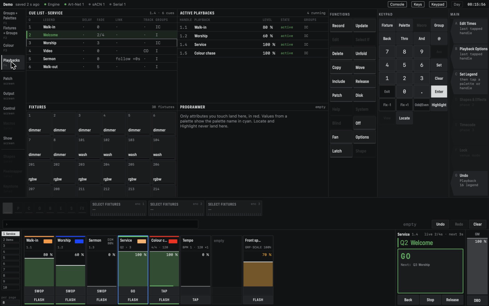
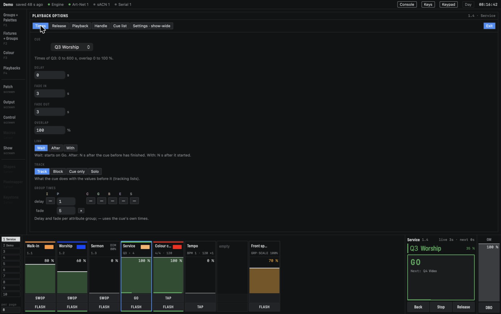

# Cue lists

A cue list is a playback with more than one cue. The cues are numbered and run one after the
other: each **Go** starts the next one, with its own times. Some cues can follow on by themselves.
A cue list sits on a handle like any playback, with the same options for priority, release,
playback groups, paging, legend and halo (see [Playbacks and cues](playbacks.md)).

## Building a cue list

Start with a playback on a handle (see [Recording a playback](playbacks.md#recording-a-playback)).
Then, for each next cue, set up the look in the programmer, press **Record**, tap the handle and
choose:

- **Append**: a new cue at the end. Its number is the last whole number plus one: after Q7 comes
  Q8.
- **Insert**: a new cue right after the current cue, numbered half way to the next one: between
  Q2 and Q3 it is Q2.5. Go runs it next.

To give a cue a number of your own, press **Record**, type the number on the keypad, then tap the
handle: `Record`, `4.5`, tap the handle records Q4.5. If that cue exists, the softkeys ask
**Replace**, **Merge** or **Update**.

Cue numbers go from 0.001 to 9999.999, with up to three decimals. The list always runs them in
number order. A new cue gets the default times (0 s) and waits for Go.

You do not need to Clear between cues. With tracking on (the default), each cue stores only what
you changed, and the rest carries on from the cues before it. See [Tracking](#tracking).

## Running a cue list

Raise the fader of a cue list and its first cue runs. After that, press **Go**:

- the **GO** button in the Go block;
- the upper button of the list's own strip (labelled **GO**);
- **Space** on the Mac keyboard, while **Keys** is on in the status bar.

The Go block, on the right of the playback area, shows the **connected** cue list (see
[The connected list](#the-connected-list)):

- the header: the list's legend and handle, and the fade times of the live and the next cue
  (`live 3s · next 2/4s` means a fade in of 2 s and a fade out of 4 s). An amber `fader 40 %`
  warns that the list's fader is not at full, so a Go may look dimmer than you expect;
- the **now** line, large and green: the current cue's number and legend, and the progress while
  it fades. *paused* in amber while the list is paused;
- the **GO** button, with the next cue in small grey text (`Next: Q4 Sermon`). It reads *end of
  list* and is disabled when there is nothing next;
- **Back**, **Stop** and **Release** below it.

*The Playbacks workspace (F4): the Cue list window with Q2 Welcome running (green) and Q3 next
(outlined), Active playbacks next to it, and the Go block on the right showing the same list.*

What the keys do:

- **Go** starts the next cue. On a list that is off, it starts the list at its next cue, which is
  the first cue unless you tapped another row.
- **Back** goes to the cue before the current one, with that cue's fade times but without its
  delay. Shift+Space does the same while Keys is on. On the first cue it is refused.
- **Stop** pauses the list: every fade and every waiting link stops where it is, and the light
  freezes. **Go** then carries on from there. **Stop** on a paused list goes back one cue.
- **Release** lets the list go (see [Release](playbacks.md#release)). The next time it starts
  from its first cue again.

When Go reaches the last cue, the list stays there: Go has nothing next. With **Loop** on the Cue
list tab set to *Loop*, the first cue comes next after the last one.

## The Cue list window

The Cue list window is in the **Playbacks** workspace (F4). Its title shows the connected list,
its handle and how many cues it has. Each row is a cue:

- **Q**: the cue number.
- **Legend**.
- **Delay** and **Fade**: the fade shows `2` when in and out are the same, else `2/4`.
- **Link**: `·` waits for Go, `follow +1s` and `with +2s` start by themselves (see
  [Links](#links)).
- **Track**: `·`, or B, CO or S for a Block, Cue Only or Solo cue.
- **Groups**: the attribute groups the cue holds.

The current cue is green, the next one has an outline, and a fading cue shows its progress along
the bottom of its row.

**Tap a row** to make that cue the next one. Nothing changes on stage until you press Go, so a
tap in the list can never cue the wrong thing.

**Right-click a row** for the cue softkeys:

- **Go to Cue**: runs that cue now, with its own times.
- **View Cue**: shows everything the cue puts on stage (see [The Cue view](#the-cue-view)).
- **Edit Times**: opens the Times tab of Playback Options for that cue.
- **Set Legend**: a name of up to 32 characters.
- **Renumber** and **Copy**: type a free number on the keypad first, then press the softkey.
- **Delete**: confirm on softkey **A**. The last cue of a playback cannot be deleted; delete the
  playback instead.

**Record**, then a tap on a row, records onto that cue: **Replace**, **Merge** or **Update**.
**Renumber All** on the Cue list tab of Playback Options numbers the cues 1, 2, 3 … in their order.

## Times per cue

Every cue has its own times. Open **Playback Options** on the list (or **Edit Times** on a row)
and go to the **Times** tab. The **Cue** menu at the top picks the cue; it starts on the current
cue. For that cue you set:

- **Delay**, **Fade in**, **Fade out** and **Overlap**. Intensity that goes up uses the fade in;
  intensity that goes down uses the fade out. Colour, position and the rest use the fade in.
- **Link** (next part).
- **Track** (see [Tracking](#tracking)).
- **Group times**: a delay and fade of its own for any attribute group. Tap **—** under a group
  to give it its own times; **×** gives it back the cue's times. A cue with a fade of 2 s and
  position at delay 1 s, fade 5 s brings up the colour in 2 s and starts the movement after 1 s,
  so the heads arrive after 6 s.

*The Times tab for Q3 Worship: fade 3 s, and position with its own delay of 1 s and fade of 5 s.*

A change to the times of a cue that is fading now is used from the next Go on.

### Links

A cue's link decides how it starts:

- **Wait** (the default): it waits for Go.
- **After**, with a number of seconds: it starts by itself that long after the cue before it has
  finished fading. Use this to follow on: Sermon, then the video cue starts when Sermon is done.
- **With**, with a number of seconds: it starts that long after the cue before it *started*.

Links follow after Go, Go to Cue and other links, not after Back. **Stop** pauses a waiting link,
and **Go** while a link is waiting starts that cue at once.

## The fader on a cue list

The fader of a cue list is its intensity master: it scales the intensity of the whole list at
once. The cue times do the fading, so the fader modes of a single look are not used. The **Cue
list** tab of Playback Options sets:

- **Fader**: what 0 means. *Kill with Off* (the default) keeps the list on its current cue: the
  intensity goes out, everything else stays, and Go still works. Only Release stops it.
  *Kill at 0* stops the list when the fader reaches 0, and it starts from the top next time.
- **Fire first cue** (on by default): raising the fader of a list that is off runs its first cue.
  Off: the list comes alive with nothing on stage until you press Go.
- **Loop**: *Stop on final* (the default) or *Loop*.
- **Tracking**: on or off (next part).

The handle's **Flash** works as on a single look; on a list that is off, it starts the list.

## Tracking

With **tracking** on (the default), a cue holds only the values you recorded into it: its own
values. Everything else **tracks** from the cues before it. If Q3 changes only the colour of the
washes, the pars stay as Q2 left them, and you never have to record the pars again.

When you jump to a cue (Go to Cue, or Back), the light goes to what that cue would show had you run
the list from the top: its own values plus the tracked ones, all in that cue's times.

With tracking off, a cue shows only its own values. Intensity that a cue does not hold fades out.

Per cue, the **Track** option on the Times tab changes how it takes part:

- **Track** (the default): as above.
- **Block**: nothing tracks into this cue; it shows only its own values. Later cues track from it.
- **Cue only**: its values do not carry on. The cue after it shows what was there before, so a
  video cue that takes the pars down brings them back on the next Go.
- **Solo**: Block and Cue only together.

### Updating a tracking list

**Update** and **Merge** on a cue of a tracking list store each changed value by the **update
mode**. The show-wide default is on the Settings tab; the **Update Mode** softkey in the Record
softkeys changes it for one record:

- **Forwards** (the default): in this cue; later cues that do not hold the value take it too.
- **Cue Only**: in this cue only. The next cue gets the old value, so later cues stay as they were.
- **Backwards**: in the cue the value tracks from, so every cue in between changes too, and not
  after this cue.
- **Both**: in the cue the value tracks from, and onwards until a cue holds the value itself.

On a tracking list, Update takes the values the cue shows, tracked ones included. With tracking
off, every mode stores in the cue itself.

### The Cue view

**View Cue** shows the whole state of a cue in place of the Cue list window: a row per fixture,
with columns for intensity, position, colour and beam. Values the cue holds itself are in normal
text, tracked values are **magenta**, and palette references are **cyan** with the palette's
name.

Right-click a value the cue holds itself and press **Remove** (then confirm) to take it out of the
cue, so it tracks from the cues before it again. A tracked value cannot be removed here: remove it
from the cue it comes from. **Back to List** returns to the Cue list window.

## The connected list

The Go block, Space and the Cue list window always work on one cue list or chase: the
**connected** list. Its strip has a blue frame. It changes when:

- you tap the legend of a list's strip (with no function button armed);
- a list starts, or gets Go from its own handle, while **Auto connect** is on (the default, on the
  Settings tab);
- the connected list is deleted or there was none: the first list in the show takes over.

Connecting a list never changes what is on stage. Each list on a handle keeps its own Go button,
so you can run two lists at once.

## Handle buttons

The two buttons of a handle follow what is on it. The **Handle buttons** setting on the Settings
tab chooses the set for the whole show:

- **Best practice** (the default): Swop and Flash on a single look, Go and Flash on a cue list, Tap
  and Flash on a chase, Tap on a BPM master, Flash on a group master.
- **Titan**: Swop and Flash on every kind (Tap on a BPM master). Go is then only in the Go block
  and on Space.
- **Custom**: pick both buttons per kind, from what that kind can do: Flash, Swop, Go, Back, Stop,
  Tap or Release.

A handle's own Go always works on its own list, whichever list is connected.

Next: [Running a show](running.md).
