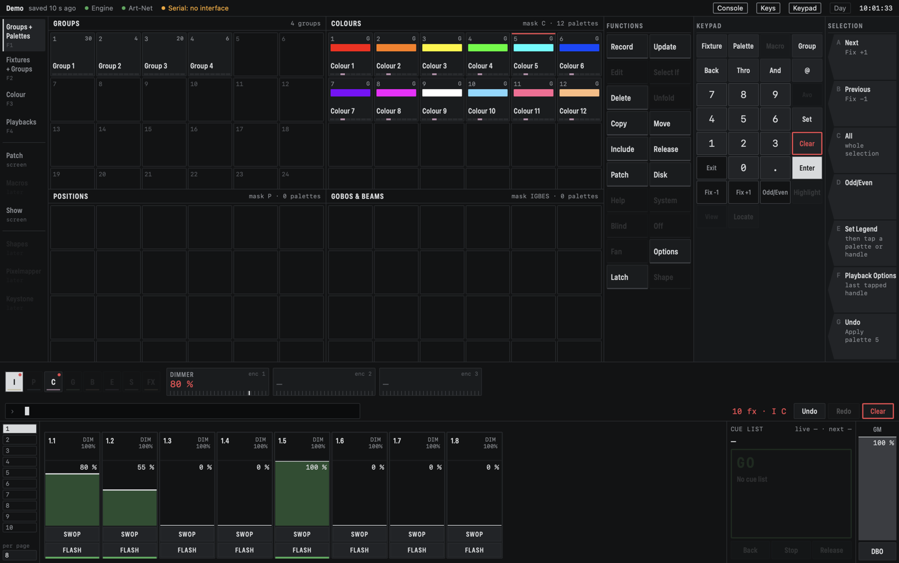

# Introduction

CMDMX is a lighting console for macOS. It runs on a Mac, talks to your lights over a network or a
USB DMX interface, and is controlled with the mouse and keyboard, a MIDI controller, a tablet or a
Stream Deck.

*The main screen, showing a demo rig.*

## Build once, play back many ways

The idea behind CMDMX is that a show is made of building blocks that you program once:

- **Fixtures** are your lamps, patched to DMX addresses.
- **Palettes** are saved colours, positions and beam settings you can reuse everywhere.
- **Cues** are saved looks. A cue can refer to a palette instead of copying its values.

You then play those blocks back in the way that suits the moment:

- as a **cue list**, stepping through the show with Go and Back;
- as **pages of playbacks** on faders and buttons, for busking by hand;
- or both in the same show.

A timeline, where cues are placed against time, is a later idea. It is not in CMDMX yet.

## Two programs, one reason

CMDMX is two programs working together. The **engine** is a small background program that does all
the lighting work and sends the DMX output. The **app** is what you see and touch. It shows what
the engine is doing and sends it your commands.

This split is what makes it safe to use live. If the app hangs or crashes, the engine carries on
and the lights do not change. When you start the app again it reconnects and shows the current
state.

## What it does not do yet

- A timeline and synchronising to music software are not built.
- Macros, Shapes, Pixelmapper and Keystone are marked "later" in the app and are greyed out.
- It is still in development. The first version, 0.1.0, is out, but it has not yet been used for
  a full service. Treat it accordingly and keep a fallback.
- The app is not notarised by Apple, so the first launch needs an extra step (see
  [Getting started](getting-started.md)).

The code lives at [github.com/Aottens/CMDMX](https://github.com/Aottens/CMDMX). Its licence is
"all rights reserved".

Next: [Getting started](getting-started.md), then [Concepts](concepts.md).
