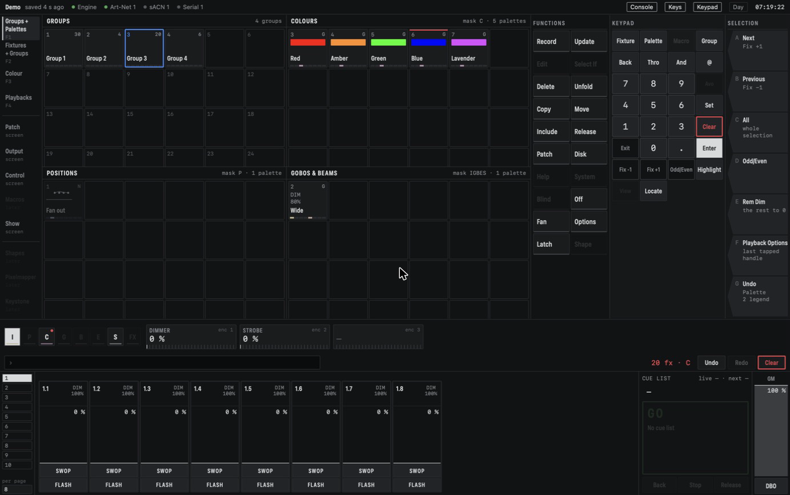

# Palettes

A palette is a saved colour, position or beam setting that you can apply with one tap. Cues and
playbacks that use a palette remember *which* palette they used, so changing the palette later
changes every look that uses it (see [Concepts](concepts.md#palettes-are-references)).

The **Groups + Palettes** workspace (F1) shows the three palette windows next to the groups:

- **Colours**, which records colour by default (mask C);
- **Positions**, which records position (mask P);
- **Gobos & Beams**, which records the other groups: intensity, gobo, beam, effects and control
  (mask IGBES).

The window only sets the default mask. What a palette holds comes from what you recorded into
it, not from the window it sits in.

*Colour palettes with their swatches and the G tag, a fanned position palette with the N tag, and
a beam palette. Palette 6 (Blue) has the red top strip: it is in use in the programmer.*

## What a palette cell shows

A used cell shows the palette's number at the top left and its kind at the top right (**G**,
**S** or **N**, see below). In the middle is its icon: a colour swatch, a drawing of the
positions, or a short text such as the zoom or dimmer level. Below that is its legend, which is
"Colour 3" or "Position 1" until you name it. The strip at the bottom shows which attribute
groups it holds.

- A **red strip at the top** means the palette is in use in the programmer.
- A **dimmed** palette does not fit the current selection: it holds nothing those fixtures have.

## Recording a palette

1. Select fixtures and set the values you want, for example a colour.
2. Press **Record**. It gets a red ring.
3. Tap an empty cell in the right window.

The palette takes the next free number. It stores the values in the mask from **every fixture in
the programmer**, not only the selected ones. Located and highlight values are never recorded.
If there is nothing in the mask, the record is refused with a message.

A quicker way: **double-click** an empty cell without pressing Record first.

While Record is armed, the softkeys at the right change the next record:

- **Mask** switches the attribute groups I P C G B E S on and off. It starts from the window's
  mask.
- **Record By** chooses *Mixed* (the default) or *Channel*. Mixed stores colour and position as a
  whole: if you touched Pan, Tilt is stored too, at its current value. Channel stores only what you
  touched.
- **Record as** chooses *Auto*, *Normal* or *Shared* (see the next part).
- **Cancel** disarms Record.

## The three kinds: Global, Shared and Normal

A palette stores its values on one of three levels. CMDMX picks the widest level that fits what
you recorded and shows it with a tag:

- **G, Global:** one value for any fixture that has the attribute. Only intensity, Pan, Tilt and
  colour can be global. A red recorded on your RGBW pars also works on your RGB pars and on a wash
  you add next year. Global Pan and Tilt are stored as an angle, so the same palette points
  heads with a different pan range in the same direction.
- **S, Shared:** one value per *type* of fixture. A zoom of 40 % on all washes is stored once for
  the wash type, and works on every fixture of that type.
- **N, Normal:** one value per fixture. Four washes pointing at four different spots give four
  separate values; the palette works only on those fixtures.

With **Record as Auto** CMDMX decides: if all fixtures of a type got the same values, the palette
is shared, and attributes that are the same for every type become global. Otherwise it is normal.
A palette recorded from one fixture counts as shared. **Normal** forces a per-fixture palette;
**Shared** keeps it off the global level, and is refused when the values differ within a type.

## Applying a palette

Select fixtures and tap the palette. Every selected fixture that the palette fits gets it;
attributes and fixtures it does not fit are left alone. If it fits none of them, it is refused
with a message.

In the programmer the values are *references* to the palette. The Programmer window shows them in
cyan with the palette's legend, instead of red.

You can also type `Palette 6 Enter` on the command line, or put a selection in front of it:
`201 Thro 208 Palette 6 Enter`.

### Quick palettes

Tap a palette with **nothing selected** and it goes to every fixture it fits. The selection stays
empty. Tap a colour palette with nothing selected and the whole rig takes that colour.

### Include

**Include**, then tap a palette, puts the palette's values in the programmer as ordinary values
instead of references. Use it to take a palette as a starting point, change it, and record it
back.

## Fade time and overlap

To apply a palette with a fade, type the time in seconds on the command line and then tap the
palette: `3`, then the palette, fades to it over three seconds. The line empties after the tap.

**Overlap** spreads the fades over the targets in their order. At 100 % all fixtures fade
together. At 50 % each fixture starts when the one before it is halfway, so the colour runs
across the rig. The time you type is the fade of each fixture, so a low overlap makes the whole
run longer.

Press **Palette** on the keypad with an empty command line to open the Palette softkeys:

- **Master Time:** type a number first, then press it, to set the fade time that every palette tap
  uses when you type none. It starts at 0 s.
- **Master Overlap:** the same for overlap. It starts at 100 %.
- **Set Overlap:** an overlap for the next tap only.
- **Cancel** closes the softkeys.

A fade never gets in your way. Turning a wheel, applying another palette or clearing takes over
from wherever the fade has got to.

## Changing palettes

- **Record onto a used cell.** Press Record and tap the palette. The softkeys offer
  **Replace** (new contents), **Merge** (add the new values and overwrite the ones that are
  there) and **Quick Merge** (only update the attributes the palette already holds). Tapping the
  same cell again is Quick Merge too. A merge never makes the palette wider than its kind: a
  normal palette stays normal.
- **Update**, then tap a palette: a Quick Merge with what is in the programmer.

Every cue and playback that uses the palette follows the change straight away, without a fade.

## Managing palettes

- **Set Legend** (a softkey, or **Set** on the keypad), then tap a palette, opens an editor:
  the legend, the palette's number, and the icon library by category. **Auto** gives back the
  automatic icon.
- **Copy**, then tap a palette and an empty cell, makes a copy with the next free number. Looks
  that used the original keep using the original.
- **Move**, then tap a palette and an empty cell, moves it. Its number stays, and looks that use
  it keep using it.
- **Delete**, then tap a palette, and confirm on softkey **A**. Cues and playbacks that used it
  keep the values the palette gave when they were recorded.

Palettes are saved with the show. Recording, changing and deleting them can be undone.

Next: playbacks and cues are covered in the next sections of this manual, which are not written
yet.
