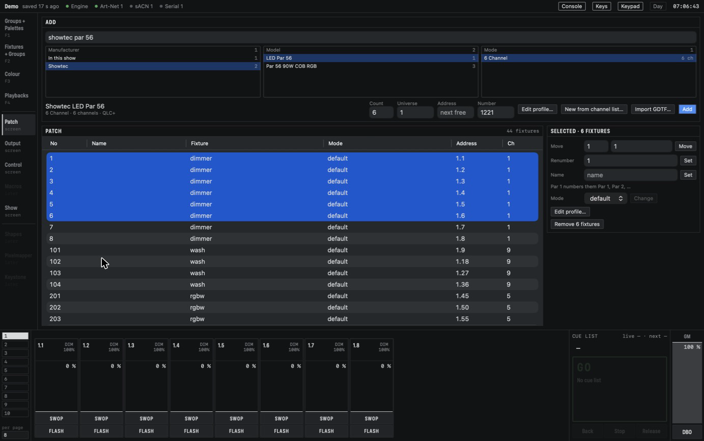
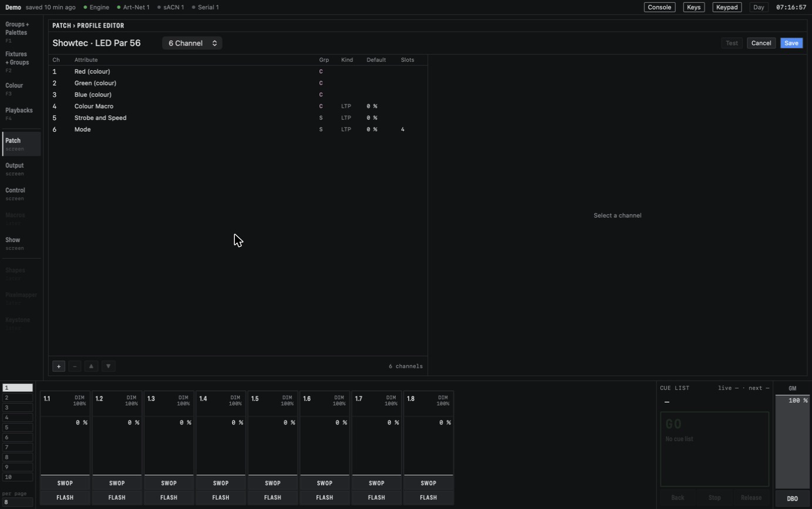
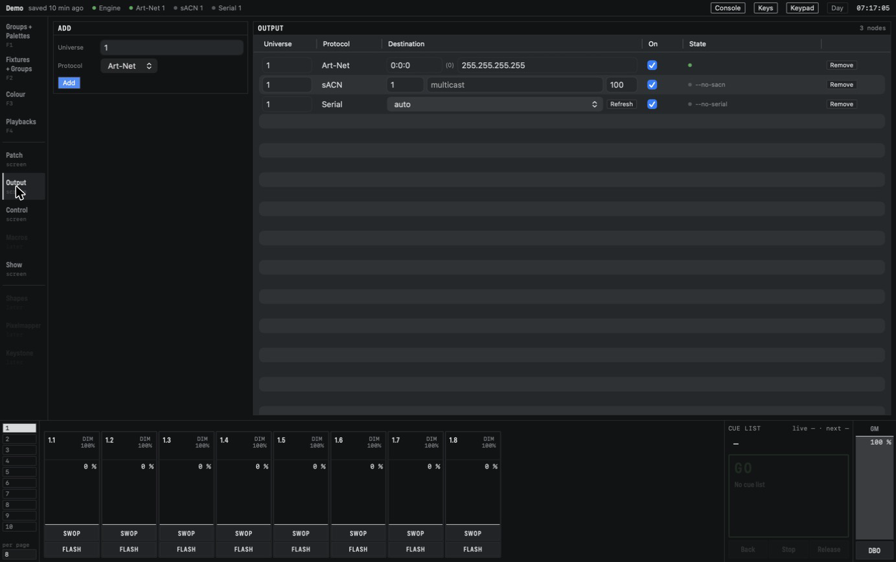

# Patching

Patching tells CMDMX which lamps you have and where they listen. Click **Patch** in the rail on the
left (or the **Patch** function key) to open the Patch screen. It fills the window: the *Add*
panel along the top, the patch table below it and the *Selected* panel on the right. Click
**Patch** again, or a workspace, to go back.

*The Patch screen: a model picked in the Add panel, and six fixtures selected in the table.*

## The fixture library

CMDMX looks for profiles in two places:

- **The QLC+ set.** The app comes with the fixture definitions of the open QLC+ project, nearly
  1,800 lamps from about 150 manufacturers. CMDMX converts a definition into its own
  profile when you pick it.
- **Your user profiles.** Profiles you import, make or edit are saved in
  `~/Library/Application Support/CMDMX/profiles/`. A user profile with the same manufacturer and
  model hides the QLC+ one. In the lists it carries a `USER` tag.

### Finding a fixture

The Add panel has one search field and three columns: **Manufacturer**, **Model** and **Mode**.

- With an empty search, Manufacturer lists every manufacturer with its number of models. On top
  sits **In this show**, the profiles that are already patched.
- Type a few words, such as `showtec par 56`. The manufacturers narrow to those with a matching
  model, and Model lists the matches.
- Pick a model to see its modes with their channel counts. The line under the columns shows what
  you picked, for example *6 Channel · 6 channels · QLC+*.

You can stay on the keyboard: the down arrow goes from the search field into the columns, the
arrow keys move within and between them, and Return adds the fixture.

### Importing GDTF

**Import GDTF…** opens a `.gdtf` file, the format many manufacturers publish on GDTF-share. CMDMX
turns it into a user profile and shows a report: per mode and channel, the GDTF name and what it
became, followed by any warnings. Close it with **Done** or Escape. The new profile is picked in
the Add panel, ready to patch. Importing the same file again replaces the earlier user profile.

A file that is not valid GDTF is refused with a message that names the file. Output keeps running
while a file is imported.

## The profile editor

**Edit profile…** opens a full-screen editor for the picked model, or for the selected fixture
from the Selected panel. **New from channel list…** opens the same editor on an empty profile,
for a lamp that is not in the library.

*The profile editor on one mode of a fixture. Select a channel on the left to edit it on the right.*

- **Channels.** The list shows each channel's number, attribute, group, kind (HTP or LTP), default
  and slots. Select a channel to set its name, its attribute group (I P C G B E S FX), HTP or LTP,
  and its default, Locate and Highlight levels. Levels are in percent, with the DMX value beside
  them. **+** adds a channel, **−** removes one, and the arrows move it. A fine channel belongs to
  its coarse channel and has no settings of its own. Colour mixing channels such as Red, Green
  and Blue keep their role; only their name can change.
- **New channels.** In a new profile, **+** offers the channel types: Dimmer, Pan, Tilt, the colour
  components, an *Emitter* (an extra colour such as Lime, with its name) or *Other* (with a name,
  group and default).
- **Slots.** A wheel or a channel with several ranges is split into *slots*, each with a From and To
  value and a name. A colour slot can also have a colour. **+ Slot**, **Split**, **Merge with
  next** and remove work on the list; the bar under it shows the ranges, and clicking a range
  selects its row.
- **Auto-mix emitters.** On a mode that mixes red, green and blue, the mode bar has an
  **Auto-mix emitters** switch. Switched on, the engine makes the picked colour with the extra
  emitters as well (White, Warm White, Amber, Lime …). Each emitter then shows its colour as CIE x
  and y and its **Output** in percent: how bright it is at full compared with the fixture's own
  white from red, green and blue (200 % for a White LED twice as bright). Switching on fills in
  the usual values for White, Cold White, Warm White, Amber and Lime once; correct them from the
  fixture's data sheet. A status line says **Auto-mixed**, or **Direct only** with the reason: no
  colour entered, or a colour outside what the engine can mix (UV, deep indigo). A direct-only
  emitter keeps its own wheel and is not mixed.
- **Test.** Select fixtures on a workspace first, then switch **Test** on (it turns red). Clicking a
  slot or moving a default now sends that value to the selected fixtures, so you can check a gobo
  or colour against the lamp. The values stay in the programmer when you leave; **Clear** removes
  them.
- **Save** sends the profile to the engine, which checks it as a whole. It is refused, with the
  reason, when slots overlap, when a channel you remove is still used in a palette, cue or the
  programmer, or when a patched mode would change its number of channels. The editor then stays
  open with your changes. **Cancel** asks first if you changed something.

A saved profile is a user profile, and the show uses it straight away. Saving can be undone with
Command-Z.

## Adding fixtures

With a model and mode picked, fill in the fields of the Add panel and click **Add**:

- **Count:** how many fixtures to add.
- **Universe** and **Address:** where the first one starts. The others follow back to back.
- **Number:** the user number of the first one. The others count up.

Leave Address or Number empty and CMDMX takes the first free channels and the next free numbers.
A patch that would overlap another fixture, or a number that is in use, is refused with a message
that names the clash. Nothing changes then.

## The patch table

The table lists every fixture, sorted by number: number, name, profile, mode, address as
`universe.address` (for example `1.45`) and footprint. A mode that mixes colour without a dimmer
channel says *virtual dimmer*: CMDMX gives it a dimmer of its own.

Click a row to edit it in the Selected panel:

- **Move** to another universe and address.
- **Renumber** to another user number.
- **Name** the fixture.
- **Mode**: pick another mode of the same profile and click **Change**. It asks to confirm, and
  keeps the values the fixture had for the attributes both modes share.
- **Remove**: asks to confirm. The fixture's channels go to zero and it leaves its groups.

### Working on many fixtures at once

Click one row and Shift-click another to select a range, Command-click to add or drop a row, or
press Command-A for all of them. The panel then reads *Selected · 6 fixtures*.

- **Move** places them back to back from the address you give, in table order.
- **Renumber** numbers them up from the number you give, in the same order.
- **Name** with a number at the end numbers them: `Par 1` gives Par 1, Par 2, Par 3 and so on.
  A name without a number gives all of them the same name.
- **Mode** lists only the modes they all have.
- **Remove** removes them all, after you confirm.

Each of these is one step for Undo, and each is refused as a whole when one fixture would clash.

## Universes and output nodes

A **universe** is one set of 512 DMX channels. An **output node** sends a universe somewhere: as
Art-Net or sACN on the network, or to a USB DMX interface.

When you patch the first fixture on a new universe, CMDMX adds an Art-Net and an sACN node for it,
and the message line says so. Click **Output** in the rail to see and edit the nodes.

*The Output screen: one row per node, with its universe, protocol, settings and state.*

- Each row has an **On** tick and a coloured dot for its state. Untick a node to stop it
  without removing it.
- **Art-Net** has a port address, such as `0:0:1`, and a destination (broadcast by default).
- **sACN** has a priority (0–200) and sends by multicast, or to one address you type.
- **Serial** is a USB DMX interface. Choose its port from the dropdown; see
  [Connect output](getting-started.md#connect-output).
- The *Add* panel on the left puts a new node on a universe: type the universe, pick the protocol
  and click **Add**. **Remove** asks to confirm first.

A universe with fixtures but no node gets a warning row above the table. Two nodes that are on cannot
send to the same destination, such as one Art-Net port address; the edit is refused and the
field returns to its old value. Output
edits can be undone.

Next: [Programming](programming.md).
