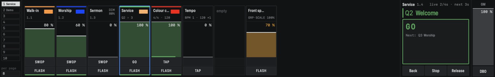
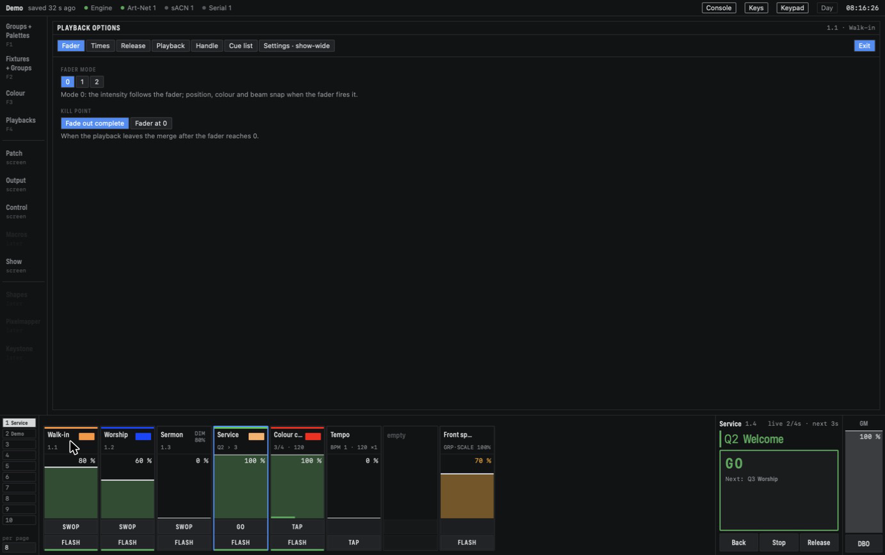

# Playbacks and cues

A playback is what you play during a show: a fader and two buttons in the playback area at the
bottom of the screen. Each playback holds one or more **cues**. A playback with one cue is a
single look; with more cues it becomes a cue list (see [Cue lists](cuelists.md)) or a chase (see
[Chases](#chases) below).

## Handles and strips

The playback area has a column of page buttons on the left, a strip per fader in the middle, the
Go block and the Grand Master on the right. A place for a playback is a **handle**, written as
page and slot: **2.3** is slot 3 on page 2. There are ten pages, and as many slots per page as the
show's *faders per page* setting (eight by default; the number is shown under the page buttons).

*Page 1: three looks on 1.1 to 1.3, the cue list Service on 1.4 (connected, blue frame), a chase
on 1.5, a BPM master on 1.6 and a group master on 1.8. Running playbacks have a green strip along
the bottom.*

Each strip shows, from top to bottom:

- the **legend area**: a coloured top bar (the **halo**), the legend on the left, or the handle
  number while there is no legend, and an icon on the right. A second line says more for some
  kinds: `Q3 › 4` on a cue list (current and next cue), `2/8 · 120` on a chase (step and BPM), or
  what a master does;
- the **level bar** with the level in %. Drag it, or scroll over it (Option for fine steps, Shift
  for big ones);
- the two **handle buttons**. What they do depends on what is on the handle: Swop and Flash on a
  single look, Go and Flash on a cue list, Tap and Flash on a chase.

A green strip along the bottom means the playback is running; an amber one means it is releasing
(its values are fading back, see [Release](#release)). An empty handle shows *empty*.

## Recording a playback

1. Set up a look in the programmer: select fixtures and set values, or apply palettes.
2. Press **Record**. It gets a red ring and the legends get a red outline.
3. Tap the legend area of an empty strip.

The playback stores what is in the programmer for **every fixture in the programmer**, not only
the selected ones. Located and highlight values are never stored. If there is nothing to record,
it is refused with "Nothing in the programmer to record". The programmer is left as it was, so
you can go on from there.

Palettes stay palettes: a colour you applied from a palette is stored as a reference to that
palette (see [Palettes](palettes.md)). Change the palette later and the playback follows.

While Record is armed, the softkeys set what this one record takes:

- **Mask** switches the attribute groups I P C G B E S on and off. For a playback it starts with
  everything on.
- **Record By**: *Channel* (the default for playbacks) stores only the attributes you touched;
  *Mixed* stores a touched fixture's whole colour and position. Channel is what lets a cue list
  carry values from one cue to the next (see [Tracking](cuelists.md#tracking)).
- **Cancel** disarms Record.

### Recording onto a used handle

Tap a handle that already holds a playback and the softkeys ask what to do:

- **Replace**: the playback gets the new contents. Its legend, options and times stay.
- **Merge**: the new values are added, and overwrite the ones that are there.
- **Append** and **Insert** add a new cue, which turns the playback into a cue list. See
  [Cue lists](cuelists.md#building-a-cue-list).

**Update**, then a tap on a handle, stores what is in the programmer only for the attributes and
fixtures the playback already holds.

A running playback that you record into changes on stage straight away, without a fade.

## Managing playbacks

These are function buttons in the side column. Press one, then tap a strip's legend:

- **Copy**: tap the playback, then an empty handle. The copy gets the same cues, legend, halo and
  options.
- **Move**: tap the playback, then an empty handle. A running playback keeps running.
- **Delete**: tap the playback and confirm on softkey **A**. A running playback is stopped first.
- **Set Legend**: opens an editor with the legend (up to 32 characters), the icon library with
  **Auto** for the automatic icon, and a halo row: **Auto**, eight colours and a colour picker.
- **Options**: opens the Playback Options screen (next part).

Copy and Move onto a used handle are refused. Recording, deleting and changing playbacks can be
undone.

### Icons and halos

The automatic icon comes from the first cue: a colour swatch when it holds colours, otherwise a
drawing of positions, otherwise a short text such as `DIMMER 100%`. The automatic halo is the
cue's first colour; a cue without colour has no halo. A picked icon or halo replaces the automatic
one until you choose **Auto** again.

## Playback Options

**Options**, then tap a handle, opens the options. A right-click on a strip's legend does the
same, and so does the **Playback Options** softkey (it opens the handle you tapped last). The
screen takes the place of the windows; the strips, the Grand Master and the status bar stay, so
you can try a change straight away. Every change is sent at once. **Exit** closes the screen.

*Playback Options for the single look on 1.1: the tabs along the top, Exit on the right.*

The tabs depend on the kind of playback. A single look has these:

- **Fader**: fader mode and kill point.
- **Times**: delay, fade in, fade out and overlap. The **Edit Times** softkey opens this tab.
- **Release**: release mask and release time.
- **Playback**: priority and playback group.
- **Handle**: paging (see [Running a show](running.md#pages)).
- **Cue list**: the kind, Cues or Chase.
- **Settings · show-wide**: settings for every playback, and the programmer's Clear settings.

## Times and fader modes

A new playback starts with every time at 0 and overlap at 100 %. Set the times on the Times tab:

- **Delay**: how long after the fader goes up before anything happens.
- **Fade in**: how long the intensity takes to come up, and how long colour, position and the
  other values take to move to the cue.
- **Fade out**: used by fader mode 1 (below).
- **Overlap**: spreads the fades over the fixtures, in user-number order, as for palettes. At
  100 % they all move together.

The **fader mode** decides how the fader and the times work together:

- **Mode 0** (the default): the intensity comes up with the fader over the fade-in time. Push the
  fader to full in one move with a fade in of 3 s, and the light reaches full after 3 s. Pulling
  the fader down takes the intensity down at once. Colour, position and the rest move to the cue
  in the fade-in time as soon as the fader starts to go up; the fader does not scale them.
- **Mode 1**: as mode 0, but pulling the fader down fades the intensity out no faster than the
  fade-out time.
- **Mode 2**: the times are ignored. The fader crossfades every value: at half way, a pan that
  goes from 20 % to 80 % sits at 50 %. At 0 everything is back where it was before.

The **kill point** decides when the playback lets go after its fader reaches 0:

- **Fade out complete** (the default): when the intensity has faded out.
- **Fader at 0**: at once, even in the middle of a mode-1 fade-out.

## Release

When a playback lets go, its intensity is gone. Colour, position and the other values stay where
it left them, unless they are in its **release mask**. Attributes in the mask fade back to what
the other playbacks give them, or to where they were before, over the **release time**.

On the Release tab:

- **Release mask**: *Global* uses the show's setting. By default nothing releases. *Local* gives
  this playback its own mask, with a toggle per group (I P C G B E S).
- **Release time**: *Global* uses the show's setting (2 s by default); *Own* gives this playback
  its own time.

**Release**, then a tap on a running playback, stops it at once and fades **everything** it holds
back over its release time, whatever the mask says. Its fader may still be up: it has to go to 0
and back up before the playback runs again. A tap on a row of the Active playbacks window (see
[Running a show](running.md#active-playbacks)) does the same.

## Priority and playback groups

On the Playback tab:

- **Priority**: Low, Normal (the default), High, Programmer or Very high. See
  [Concepts](concepts.md#priority).
- **Playback group**: None, or a number from 1 to 99. When a playback of a group comes up, every
  other running playback of that group goes out, as if its fader had gone to 0. Its fader stays
  where it is, so it has to go to 0 and back before it runs again. Put the walk-in, worship and
  sermon looks in one group and raising one takes the others out.

## Flash, Swop and Latch

- **Flash**, held: the playback goes to full, ignoring its fade-in. Let go and it follows its fader
  again at once.
- **Swop**, held: as Flash, and the intensity of every other playback goes to 0 while you hold it.
  Their colour and position stay, and so does the programmer.
- **Latch**, a function button, then **Flash** on a handle: the Flash stays on after you let go.
  The button is drawn inverted. The next Flash press on that handle lets it go.

## Chases

A chase steps through its cues by itself, at a tempo. Its cues are called **steps**.

1. Record the first step onto a handle, then **Append** the other steps (see
   [Cue lists](cuelists.md#building-a-cue-list)).
2. Open **Options** on the handle, go to the **Cue list** tab and set **Kind** to **Chase**.

Switching back to Cues turns it into a cue list again, with the same cues. The **Chase** tab sets:

- **BPM**: steps per minute, 1 to 600 (default 120).
- **Crossfade**: how much of each step is a fade. 0 % snaps from step to step; at 50 % each step
  fades for half its time and holds for the other half; 100 % fades all the way.
- **Direction**: Forward, Backward, Bounce (1 2 3 2 1 …) or Random (never the same step twice in a
  row).
- **Loop**: *Loop* (the default) goes round and round; *Stop on final* runs once and stays on its
  last step.
- **Speed source**: *Free* uses the BPM above. *BPM master* or *Rate master* lets a master
  handle set the tempo (see [Running a show](running.md#speed-masters)).

The steps' own times are not used.

The fader of a chase is its intensity. Raising it starts the chase from its first step; pulling it
to 0 stops it, and next time it starts from the top again. The strip shows the step and the tempo,
for example `2/8 · 120`.

**Tap** (the upper button of a chase, or **Tap** in the Go block) sets the tempo by tapping. Tap
twice or more in time with the music: the chase takes the average of your last few taps, and its
next step falls on your tap. A pause of more than two seconds starts a new count. You can also
type a tempo in the Go block's BPM field, or scroll over it (Shift for steps of 10, Option for 0.1).
Go, Back and Stop work on a chase too: see [Cue lists](cuelists.md#running-a-cue-list).

## Fixtures with cells

Some fixtures have several cells, such as an LED bar with separate segments. **Unfold**, then a
tap on such a fixture, shows its cells so you can select them one by one. A cue can hold values
for the whole fixture and for single cells. Within one cue, a cell's own value beats the
fixture's value. When a later cue in a list no longer holds a value for a cell, that cell goes
back to following its fixture.

Next: [Cue lists](cuelists.md).
