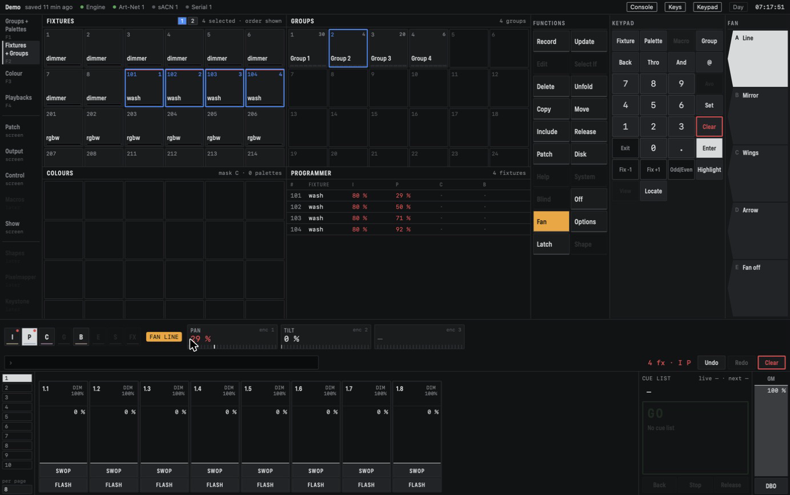
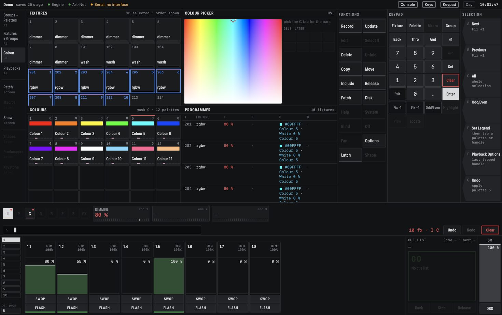

# Programming

Programming is building a look: you select fixtures, change their values, and record the result
as a palette, a group or a playback. Everything you change goes into the *programmer* first (see
[Concepts](concepts.md#the-programmer)).

The **Fixtures + Groups** workspace (F2) is a good place to start: it shows the Fixtures window,
the Groups window, the colour palettes and the Programmer window.

*Four washes selected in order (the small numbers on the buttons), Fan on with the Line curve, and
the Programmer window showing their Pan values spread out.*

## Selecting fixtures

### Tapping

Tap a fixture button to select it; it turns blue. Tap it again to deselect it. The order in which
you tap counts: each selected button shows its place in the selection, and stepping, patterns and
Fan follow that order.

Tap a group to add its fixtures in the group's own order. Fixtures that are already selected keep
their place. Tapping a group whose fixtures are all selected deselects them.

Once you have changed a value, the next tap starts a new selection. The fixtures you worked on
keep their values in the programmer. So you can select the washes, set them, then tap a par and
carry on with just that par.

### The command line

The keypad builds a line of commands under the attribute bar; **Enter** runs it. A typed
selection replaces the current one.

- `201 Thro 208 Enter` selects 201 to 208. `208 Thro 201` selects them in reverse order.
- `201 And 205 Enter` selects two fixtures.
- `Group 3 Enter` selects group 3.
- `201 Thro 208 @ 50 Enter` selects them and sets their intensity to 50 %. With fixtures selected,
  `@ 80 Enter` sets the selection to 80 %.
- Ending the line with **Locate** instead of Enter selects and locates in one go.
- `201 Thro 208 Lee 106 Enter` selects them and gives them LEE 106's colour (see
  [The gel book](#the-gel-book)). With fixtures selected, `Lee 201 Enter` does the same.

**Back** removes the last word, **Exit** empties the line. A line the engine cannot use is refused
with a message next to it, and nothing changes.

With **Keys** on in the status bar, the Mac keyboard types into the line as well: the digits, `-`
for Thro, `+` for And, `@`, `f` for Fixture, `g` for Group, `p` for Palette and `l` for Lee. Return is Enter and
Escape is Exit.

### Stepping and patterns

These work on the selection without changing it. The part they pick out is called the *targets*;
the wheels change only the targets.

- **Fix +1** and **Fix −1** step through the selection one fixture at a time, and wrap around at the
  ends. The current one has an outline.
- **Odd/Even** splits the selection in two: the first, third, fifth fixture and so on, then the
  others. Fix +1 moves to the other half.
- **All** (a softkey) ends the stepping, so the whole selection is the target again. With nothing
  stepped it selects every fixture that is in the programmer.

The same keys are on the *Selection* softkeys at the right, together with **Rem Dim**.

## The attribute bar and the wheels

The attribute bar shows the groups **I P C G B E S FX**. A group is available when the selected
fixtures have attributes in it. Pick one and the wheels show its attributes; the encoders on a
connected controller follow the same page.

Drag a wheel up or down to change its value on every target. Values you change turn red, and the
fixture gets a red strip. Hold **Option** while dragging for fine steps, or **Shift** for big
steps.

**Off** takes the active attribute group out of the programmer for the targets, so a playback can
show through again for just that group. To take out one attribute, double-click its name above
the wheel.

## The colour picker

When the selection has fixtures that mix colour, the **C** group shows four buttons, **HSI**,
**RGB**, **CMY** and **K**, with wheels for that model. They are four views of the same colour:
switching between them never changes the output. **K** shows one Kelvin wheel along the line of
white light, from 1800 K (candle) to 10000 K (blue sky), read as for example "3200 K"; it reads
"—" while the colour is black. Extra emitters, such as White or Lime, have a wheel of their own;
it changes only the fixtures that have that emitter.

Above the gel book, the picker has two rows of colour-correction steps: **CTO** ⅛ ¼ ½ Full warm the
colour like an orange correction gel, **CTB** ⅛ ¼ ½ Full cool it like a blue one. They move the
colour along the line of white light, as real correction gels do: CTB makes a cooler white, not a
saturated blue. Each step is a fixed shift in mired, so ½ CTO takes 3200 K to about 2540 K and
6500 K to about 3800 K. They work in every model and keep the brightness.

### The gel book

Below the CTO and CTB rows sits the gel book: a **LEE** tab, a search field and a grid of
swatches with each gel's number and name. Type a number to find it (`10` shows 101, 102, 103, …)
or part of a name (`congo` finds 181 Congo Blue). Tap a swatch to give the targets that gel's
colour, or type `Lee 201` on the command line. A gel sets the colour, not the brightness: a par
at half level stays at half level. The colour is what the gel shows in front of a 3200 K tungsten
lamp, so LEE 201 Full C.T. Blue makes daylight white, as it does on a theatre lamp.

While the colour is exactly a gel's colour, its swatch is outlined and the picker shows its name
above the field, for example "LEE 201 Full C.T. Blue". Turn any wheel and it is just a colour
again. A Colours palette recorded from one gel takes its name as legend: "L201 Full C.T. Blue".

The full LEE table ships once LEE Filters has given permission to use their data; until then the
gel book is empty.

When a fixture type *auto-mixes* its emitters (switched on in the profile editor), the engine
uses White, Warm White, Amber or Lime to make the colour you pick, so a white on an RGBW par comes
from the White LED. Such an emitter wheel shows **+AUTO** under its name: what you set on it
comes on top of the mix.

The **Colour** workspace (F3) has the Colour picker window: a field of hues and saturations to
click, next to the colour wheels.

*The Colour workspace with the colour picker.*

CMDMX holds one target colour per fixture and works out the emitter levels for each kind of
fixture itself. RGBW, RGB with Lime and plain RGB fixtures all show the same colour from one
pick. Intensity stays on the Dimmer: HSI has no intensity wheel of its own.

## Fan

Fan spreads a wheel change over the targets instead of moving them all the same. Press **Fan** in
the Functions column: it lights, and the softkeys show the curves.

- **Line:** the first and last fixture move most, in opposite directions; the middle stays.
  Good for spreading Pan.
- **Mirror:** two Lines from the middle outwards, mirrored.
- **Wings:** the outer thirds move, the middle third stays.
- **Arrow:** both ends move the same way, the middle stays. A V shape on Tilt or Dimmer.

Fan follows the order of your selection. It works on every wheel, colour included, but not on
typed levels, palettes or the colour picker. It stays on until you press Fan again (or **Fan off**)
or start a new selection; Fix ±1, Odd/Even and All keep it on. The fanned values are ordinary
values: record them like any other.

## Locate, Highlight and Rem Dim

- **Locate** brings the targets to a known state: intensity full, Pan and Tilt centred, open white,
  using the levels from the fixture profile. The fixture buttons show `LOC`. Located values are not
  recorded. Turn a wheel on a located fixture and that attribute enters the programmer from where
  it is.
- **Highlight** makes the targets stand out while you work: they go to full in open white, and
  while you step with Fix ±1 the others in the selection drop to a low level (25 % by default). Press it again to switch it off.
  It is never recorded.
- **Rem Dim** (a softkey) sets the intensity of every fixture that is not selected to zero, in the
  programmer. With nothing selected it is refused, so it can never black out the whole rig.

## Clear

**Clear** glows red while there is something selected or in the programmer.

- The first press deselects.
- The second press empties the programmer, and the playbacks show through again.

What happens to colour, position and other LTP values when they leave the programmer is a setting:
**Release** (they go back to what the playbacks or their defaults give) or **Freeze** (they stay
where they are). The Clear order (selection first, both at once, or programmer first), this setting and the Rem Dim low level
are in the show-wide part of the *Playback Options* screen, under *Programmer*.

## Groups

A group is a saved selection, with its order. The Groups window shows each group with its number
of fixtures.

- **Record a group:** select fixtures in the order you want, press **Record**, then tap a group
  cell. An empty cell gets a new group; a used one is replaced. With nothing selected the record
  is refused.
- **Use a group:** tap it, or type `Group 3 Enter`.

## Undo

Command-Z undoes the last change, and Shift-Command-Z redoes it. The Undo and Redo buttons next to
the command line do the same. A run of wheel turns on one attribute is one step. Fan on or off,
Highlight and live playing are not undo steps.

Next: [Palettes](palettes.md).
