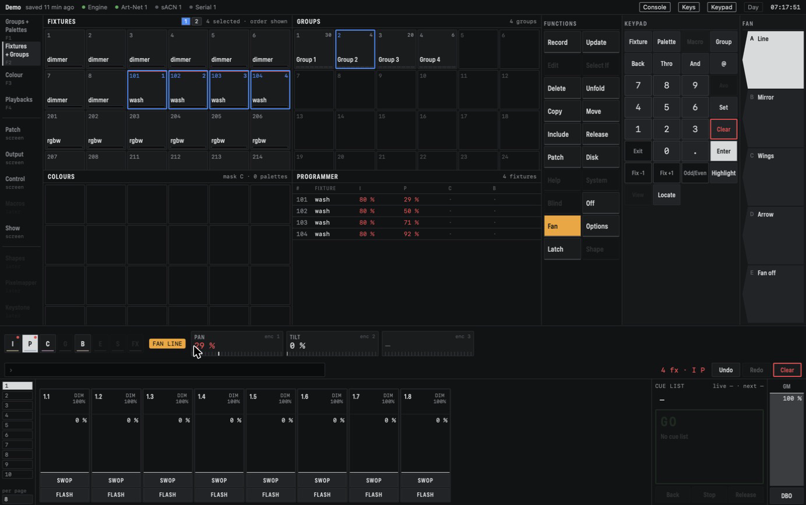
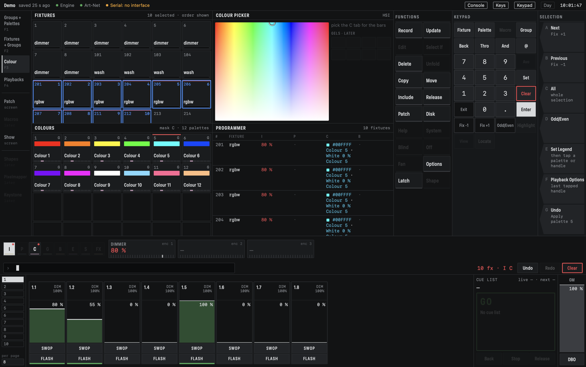

# Programming

Programming is building a look: you select fixtures, change their values, and record the result
as a palette, a group or a playback. Everything you change goes into the *programmer* first (see
[Concepts](concepts.md#the-programmer)).

The **Fixtures + Groups** workspace (F2) is a good place to start: it shows the Fixtures window,
the Groups window, the colour palettes and the Programmer window.

*Four washes selected in order (the small numbers on the buttons), Fan on with the Line curve, and
the Programmer window showing their Pan values spread out.*

## Selecting fixtures

### Tapping

Tap a fixture button to select it; it turns blue. Tap it again to deselect it. The order in which
you tap counts: each selected button shows its place in the selection, and stepping, patterns and
Fan follow that order.

When a group, the command line or a control surface changes the selection, the Fixtures window jumps
to the page of the first selected fixture and scrolls it into view. A page tab with a blue dot holds
a selected fixture, and the title says, for example, "6 selected · 4 on page 2" when some of them
are on other pages. Tapping in the Fixtures window itself never moves the page.

A fixture with a name shows its model on a second, smaller line under the name. The Find field in the
Fixtures title row matches the number (from its start), the name and the model as you type: buttons
that do not match dim and the window goes to the page of the first match. Return selects the matches
in number order, skipping any that are already selected, then empties the field and gives the keys back to the
command line; Esc empties the field without selecting.

Each fixture button has its own place: a page and a slot, as in the patch, so a gap between buttons
stays an empty button. To move a button, press **Move**, tap the fixture, then tap an empty button or
another fixture's button; the two swap places. While a fixture is taken, every slot of the page shows,
and one empty page more, so a button can go to a new page. Tap the taken fixture again to let it go.
With **Menu latch** on, Move stays armed for the next button. Moving a button changes nothing on stage
and **Undo** takes it back. Copy, Delete and Set Legend on a fixture button point you to the
[Patch screen](patching.md).

The stripe along the bottom of a fixture button shows what that fixture sends out right now: its
colour at its intensity, with masters, the Grand Master, DBO and running effects already in. A
fixture at 0 shows a dark stripe with a grey outline, so a chase runs across the buttons and a
master at 0 turns its fixtures' stripes dark. An unfolded cell's button shows that cell. The
stripe follows the engine about twenty times a second; it is what leaves the console, not a preview.

Tap a group to add its fixtures in the group's own order. Fixtures that are already selected keep
their place. Tapping a group whose fixtures are all selected deselects them.

Once you have changed a value, the next tap starts a new selection. The fixtures you worked on
keep their values in the programmer. So you can select the washes, set them, then tap a par and
carry on with just that par.

### The command line

The keypad builds a line of commands under the attribute bar; **Enter** runs it. A typed
selection replaces the current one.

- `201 Thro 208 Enter` selects 201 to 208. `208 Thro 201` selects them in reverse order.
- `201 And 205 Enter` selects two fixtures.
- `Group 3 Enter` selects group 3.
- `201 Thro 208 @ 50 Enter` selects them and sets their intensity to 50 %. With fixtures selected,
  `@ 80 Enter` sets the selection to 80 %.
- Ending the line with **Locate** instead of Enter selects and locates in one go.
- With Record or a function armed, `Group 3 Enter` or `Palette 12 Enter` is a tap on that cell. Any other line is refused and stays,
  to be corrected, and a palette that does not exist has to be tapped, because its cell decides where it goes.
- With a Delete waiting, Enter on an empty line confirms it, as softkey A does. A second tap on the target does not.
- `201 Thro 208 Lee 106 Enter` selects them and gives them LEE 106's colour (see
  [The gel book](#the-gel-book)). With fixtures selected, `Lee 201 Enter` does the same.

**Back** removes the last word, **Exit** empties the line. A line the engine cannot use is refused
with a message next to it, and nothing changes. A click on the message opens the history (see
[Messages](reference.md#messages)).

With **Keys** on in the status bar, the Mac keyboard types into the line as well: the digits, `-`
for Thro, `+` for And, `@`, `f` for Fixture, `g` for Group, `p` for Palette and `l` for Lee. Return is Enter.
Escape is Exit too, also with **Keys** off, and with nothing to exit it goes one level up (see the
[reference](reference.md)).
With **Keys** off, which is how the app starts the first time, those keys do nothing, and they or a click on the line
say so in the message zone: use the keypad, or turn **Keys** on.

### Stepping and patterns

These work on the selection without changing it. The part they pick out is called the *targets*;
the wheels change only the targets.

- **Fix +1** and **Fix −1** step through the selection one fixture at a time, and wrap around at the
  ends. The current one has an outline.
- **Odd/Even** splits the selection in two: the first, third, fifth fixture and so on, then the
  others. Fix +1 moves to the other half.
- **All** (a softkey) ends the stepping, so the whole selection is the target again. With nothing
  stepped it selects every fixture that is in the programmer.

Fix ±1 and All are also on the *Selection* softkeys at the right, together with **Rem Dim**;
Odd/Even sits there under **Pattern**.

### Order

The **Order** softkey reorders the selection without changing anything else; **Back** returns to
the Selection softkeys.

- **Reverse** turns the order around.
- **Shuffle** gives a random order, a new one every press. It is the same every time you repeat
  the same steps, so a shuffled chase in a cue replays as you recorded it.
- **Sort** puts the fixtures in number order.
- **Revert** goes back to the order in which you selected them.

The numbers on the buttons follow the new order, and so do Fix ±1, Fan, effects and palette
overlap. A dimmer chase on a reversed selection runs the other way; on a shuffled one it is a
random chase.

While Fan is on, its softkeys keep **Next**, **All**, **Order** and **Pattern** below the curves, so
you can reorder or step the selection without switching Fan off; **Back** in Order or Pattern
returns to the Fan softkeys.

### Patterns

The **Pattern** softkey lays a pattern over the selection: fixtures that share a number in the
pattern go together. Fix +1 and Fix −1 step through the numbers, so you can set the odd and the
even pars apart, or work from the outside in.

- **Odd/Even**: every other fixture.
- **1 in n**: every n-th fixture; type the number first (`3`, then 1 in n), else 3.
- **n in m**: n neighbours out of every m; type `2 Thro 6` first for Titan's "2 in 6" (a lone
  number is m, with n = 1).
- **Blocks n**: n neighbours together (else 2).
- **Divide n**: halves, thirds, quarters: `3`, then Divide (else halves).
- **Outside in**: the two ends first, then towards the middle. **Inside out** the other way.
- **Grid off** ends the pattern.
- **Next** (Fix +1) steps to the next number of the pattern without leaving it.

While a pattern is on, the attribute bar shows an amber tag such as `GRID 1 IN 3 · 2/3` (the
second of three steps) or `· ALL` after **All**; tap the tag to end the pattern. The buttons show
each fixture's number in the pattern. The pattern stays while you tap fixtures in or out and
through Order and All, and ends when a new selection starts. Fan, a new effect and palette overlap
use it: with Outside in and All, a Fan Line is mirrored around the middle and a dimmer chase runs from
both ends inwards. Record a group while a pattern is on and the group brings it back.

The keypad's **Odd/Even** key stays as it was.

## The attribute bar and the wheels

The attribute bar shows the groups **I P C G B E S FX**. A group is available when the selected
fixtures have attributes in it. Pick one and the wheels show its attributes; the encoders on a
connected controller follow the same page.

Drag a wheel up or down to change its value on every target. Values you change turn red, and the
fixture gets a red strip. Hold **Option** while dragging for fine steps, or **Shift** for big
steps.

**Off** takes the active attribute group out of the programmer for the targets, so a playback can
show through again for just that group. To take out one attribute, double-click its name above
the wheel.

## The colour picker

When the selection has fixtures that mix colour, the **C** group shows four buttons, **HSI**,
**RGB**, **CMY** and **K**, with wheels for that model. They are four views of the same colour:
switching between them never changes the output. **K** shows one Kelvin wheel along the line of
white light, from 1800 K (candle) to 10000 K (blue sky), read as for example "3200 K"; it reads
"—" while the colour is black. Extra emitters, such as White or Lime, have a wheel of their own;
it changes only the fixtures that have that emitter.

In its **Mix** view, the picker has two rows of colour-correction steps: **CTO** ⅛ ¼ ½ Full warm the
colour like an orange correction gel, **CTB** ⅛ ¼ ½ Full cool it like a blue one. They move the
colour along the line of white light, as real correction gels do: CTB makes a cooler white, not a
saturated blue. Each step is a fixed shift in mired, so ½ CTO takes 3200 K to about 2540 K and
6500 K to about 3800 K. They work in every model and keep the brightness.

### The gel book

Switch the picker from **Mix** to **Gels** and the whole window becomes the gel book: a **LEE** tab, a search
field and a grid of swatches with each gel's number and name. Type a number to find it (`10` shows
101, 102, 103, …) or part of a name (`congo` finds 181 Congo Blue). Return or Escape leaves the
search field, so the keyboard drives the command line again. Tap a swatch to give the targets that gel's
colour, or type `Lee 201` on the command line. A gel sets the colour, not the brightness: a par
at half level stays at half level. The colour is what the gel shows in front of a 3200 K tungsten
lamp, so LEE 201 Full C.T. Blue makes daylight white, as it does on a theatre lamp.

While the colour is exactly a gel's colour, its swatch is outlined and the picker shows its name
above the field, for example "LEE 201 Full C.T. Blue". Turn any wheel and it is just a colour
again. A Colours palette recorded from one gel takes its name as legend: "L201 Full C.T. Blue".

The full LEE table ships once LEE Filters has given permission to use their data; until then the
gel book is empty.

When a fixture type *auto-mixes* its emitters (switched on in the profile editor), the engine
uses White, Warm White, Amber or Lime to make the colour you pick, so a white on an RGBW par comes
from the White LED. Such an emitter wheel shows **+AUTO** under its name: what you set on it
comes on top of the mix.

The **Colour** workspace (F3) has the Colour picker window: a field of hues and saturations to
click, next to the colour wheels.

*The Colour workspace with the colour picker.*

CMDMX holds one target colour per fixture and works out the emitter levels for each kind of
fixture itself. RGBW, RGB with Lime and plain RGB fixtures all show the same colour from one
pick. Intensity stays on the Dimmer: HSI has no intensity wheel of its own.

## Fan

Fan spreads a wheel change over the targets instead of moving them all the same. Press **Fan** in
the Functions column: it lights, and the softkeys show the curves.

- **Line:** the first and last fixture move most, in opposite directions; the middle stays.
  Good for spreading Pan.
- **Mirror:** two Lines from the middle outwards, mirrored.
- **Wings:** the outer thirds move, the middle third stays.
- **Arrow:** both ends move the same way, the middle stays. A V shape on Tilt or Dimmer.

Fan follows the order of your selection. It works on every wheel, colour included, but not on
typed levels, palettes or the colour picker. It stays on until you press Fan again (or **Fan off**)
or start a new selection; Fix ±1, Odd/Even and All keep it on, and with fixtures selected the Fan
softkeys also offer Next, All, Order and Pattern. The fanned values are ordinary
values: record them like any other.

## Locate, Highlight and Rem Dim

- **Locate** brings the targets to a known state: intensity full, Pan and Tilt centred, open white,
  using the levels from the fixture profile. The fixture buttons show `LOC`. Located values are not
  recorded. Turn a wheel on a located fixture and that attribute enters the programmer from where
  it is.
- **Highlight** makes the targets stand out while you work: they go to full in open white, and
  while you step with Fix ±1 the others in the selection drop to a low level (25 % by default). Press it again to switch it off.
  It is never recorded.
- **Rem Dim** (a softkey) sets the intensity of every fixture that is not selected to zero, in the
  programmer. With nothing selected it is refused, so it can never black out the whole rig.

## Clear

**Clear** glows red while there is something selected or in the programmer.

- The first press deselects.
- The second press empties the programmer, and the playbacks show through again.

Type a time first to fade it out: `3` then **Clear** empties the programmer over 3 seconds and
keeps the selection.

What happens to colour, position and other LTP values when they leave the programmer is a setting:
**Release** (they go back to what the playbacks or their defaults give) or **Freeze** (they stay
where they are). The Clear order (selection first, both at once, or programmer first), this setting and the Rem Dim low level
are in the show-wide part of the *Playback Options* screen, under *Programmer*.

## Groups

A group is a saved selection, with its order. The Groups window shows each group with its legend
("Group 5" when it has none) and its number of fixtures.

- **Record a group:** select fixtures in the order you want, press **Record**, then tap a group
  cell. An empty cell gets a new group. A used one asks on the softkeys: **Replace** stores the selection,
  **Merge** adds the selected fixtures it does not hold after its own and keeps its grid, **Cancel**
  leaves it. Both keep the legend. With nothing selected the record is refused. **Update** does not
  work on a group: use Record and Merge.
- **Use a group:** tap it, type `Group 3 Enter` or press its button on a control surface. Each shows
  the group on the message line ("Group 5 Pars outside in"); an empty group says "Group 7 is empty"
  and the selection stays.
- **Set Legend:** press **Set Legend**, tap a group, type up to 32 characters and press Set. An
  empty field clears the legend. A group master's strip shows the legend too.
- **Copy:** press **Copy**, tap the group, then tap an empty cell. The copy has the same fixtures,
  order and legend. A group master stays on the original.
- **Move:** press **Move**, tap the group, then tap an empty cell. Its group masters follow it to
  the new number, so nothing changes on stage. There is no separate renumber: Move is the renumber.
- **Delete:** press **Delete**, tap the group, then confirm on softkey A. Cues, palettes and the
  selection hold fixtures rather than groups, so they do not change. A group that a group master
  uses is not deleted: the message line names the handle, and you delete the master first.
- **Several at once:** with Copy, Move or Delete armed, **⇧-tap** a range of groups, **⌘-tap** to add or drop one, **All**
  (softkey B) for every group, as for [playbacks](playbacks.md#working-on-many-at-once).

While one of these is armed a tap on a group does not select it, and neither does any other armed function: see
[What an armed function does](reference.md#what-an-armed-function-does). **Clear** disarms. A refusal, such
as a Copy onto a used cell, shows its warning on the message line and changes nothing. Each action
is one Undo step.

## Fixture info

Right-click a fixture tile in the **Fixtures** window (Control-click works too). A sheet opens with the
fixture's number, name, model, mode, universe and address, then the groups it is in and the cues and
palettes that use it.

Under **Now** there is one row per attribute (a cell's rows say which cell) with its value and, in words,
why: `Dimmer 0 %` and below it `Dienst Q4 gives 100 %, Master Zaal (1.8) scales it to 0 %`. It names what
gives the value (the Programmer, a cue, a palette, a value held from an earlier look, or nothing), and
what then changes it: a group master, the Grand Master, DBO, an effect, Locate or Highlight. The sheet
updates every second. Tap a row that names a playback to go to its page; the sheet closes.

## Undo

Command-Z undoes the last change, and Shift-Command-Z redoes it. The Undo and Redo buttons next to
the command line do the same. A run of wheel turns on one attribute is one step. Fan on or off,
Highlight and live playing are not undo steps.

Next: [Palettes](palettes.md).
