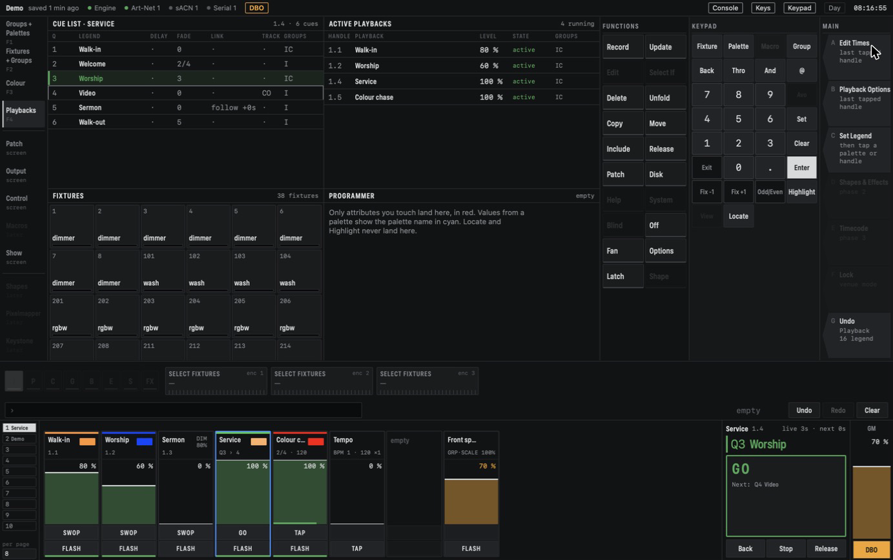

# Running a show

This section covers the controls you use while the show is on: pages, the masters, undo, and what
CMDMX does when something goes wrong.

## Pages

The page buttons on the left of the playback area switch between the ten pages. The current page
is highlighted, and the strips show its handles.

- Changing the page never changes what is running. A playback that is up on page 1 keeps running
  while you look at page 2, and shows its level again when you go back.
- **Set Legend**, then a click on a page button, names the page (up to 32 characters). The name
  is shown next to the number.

*Page 1 is named "Service". The Grand Master is at 70 % (amber), DBO is on (amber button and the
DBO tag in the status bar), and the group master on 1.8 is at 70 %.*

### Locking a handle to every page

The **Handle** tab of Playback Options sets how a playback shows across pages:

- **Unlocked** (the default): only on its own page.
- **Locked**: at its slot on every page. A playback stored at that slot on another page cannot be
  reached while the lock is there. Two locked playbacks on one slot are refused.
- **Transparent lock**: at its slot on every page where that slot is empty.

Away from its own page, a locked strip shows a lock and `page 2`. Lock the front spots on slot 8
and you can take them out for a video from any page.

## Active playbacks

The **Active playbacks** window, in the **Playbacks** workspace (F4), lists every playback that is
running or releasing, in the order they started: handle, legend, level, state and attribute
groups. The title says how many are running. A tap on a row releases that playback (see
[Release](playbacks.md#release)). It is the quickest way to find and stop something you cannot see
on the current page.

## Grand Master and DBO

The **GM** fader on the far right scales the intensity of everything: every playback, the
programmer and the group masters. It turns amber below 100 %, so a dim stage is explained.

**DBO** (dead black out) under it is a toggle. While it is on, all intensity is 0, the button is
amber and the status bar shows **DBO**. Colour, position and the rest do not change, so the rig
is ready when you switch it off again. DBO is always off when the engine starts. The GM and DBO
are the same on every page.

## Group masters

A group master is a fader that controls the intensity of one group of fixtures, whatever brings
that intensity up: the programmer, single looks, cue lists or chases.

To make one:

1. Press **Record**.
2. Press the **Group Master** softkey.
3. Tap a group in the Groups window (see [Groups](programming.md#groups)).
4. Tap an empty handle.

The strip shows the group and what the master does, such as `GRP·SCALE 100%`. It starts at
the level where it changes nothing, so making a master never changes the stage. Its level is saved
with the show. Re-record the group and the master follows the new fixtures.

The **Master** tab of its Playback Options sets the **Mode**:

- **Scale** (the default): the fader scales the group's intensity. Full is unchanged, 0 is out.
  Pushed back up, the fixtures come back to whatever the playbacks have them at now. With a
  **Scale** of 200 % (up to 1000 %) the fader can lift them above their level: at 200 %, half way
  is unchanged.
- **HTP**: the fader is a floor. The group is at least as bright as the fader, so it works as a
  quick submaster without recording anything.
- **Limit**: the fader is a ceiling. Nothing can make the group brighter than the fader.
- **Take Over**: the fader does nothing until it passes a fixture's current intensity. Then that
  fixture's dimmer goes into the programmer and follows the fader from there.

**Disabled** locks the master at the level it had: fader moves and Flash are ignored, and the strip
shows `LOCKED` and the level in amber. When a master darkens or lights its group (Scale or Limit
below 100 %, HTP above 0), its level is amber too.

Its lower button is **Flash**: the master is at full while you hold it. Group masters are never
released or stopped, and have no priority or release options.

## Speed masters

A speed master sets the tempo of the chases that follow it. Press **Record**, then the **BPM
Master** or **Rate Master** softkey, then tap an empty handle. Masters are numbered: BPM 1 to 8
and Rate 1 to 4. A chase follows one through its **Speed source** on the Chase tab (see
[Chases](playbacks.md#chases)).

- A **BPM master** holds a tempo. Its lower button is **Tap**: a tap on it sets the tempo and puts
  every running chase that follows it on the beat. Tap or type on a chase that follows it, and the
  master takes the tempo. The strip shows, for example, `BPM 1 · 120 ×1`. On its Master tab:
  - **Multiplier**: /4, /2, ×1, ×2 or ×4 on the tempo it gives its chases.
  - **Fader**: *None* (the default: the fader does nothing), *Bpm* (the fader sets the tempo, from
    0 to the **Fader maximum**, 240 BPM by default) or *Multiplier* (the fader picks the multiplier
    in five zones).
- A **Rate master** scales the speed of its chases with its fader. With the **Rate scale** at
  200 % (the default), half way is normal speed, full is twice as fast and 0 stops them. At 100 %
  full is normal speed. The strip shows the rate, for example `RATE 2 · ×1.0`.

If a chase follows a master that does not exist, it runs at its own BPM until you make one with
that number.

## The keyboard

**Keys** in the status bar lets the Mac keyboard drive the console. While it is on, **Space** is Go
and **Shift+Space** is Back on the connected list. While it is off, Space does nothing, so a stray
key never runs a cue. Space never acts while you are typing in a text field. Command-1 to
Command-4 switch workspaces whether Keys is on or not.

**Console** in the status bar puts the app full screen with the Dock and menu bar hidden, and
asks before quitting.

## Undo

Command-Z undoes the last edit and Shift-Command-Z redoes it; the **Undo** softkey shows what it
will undo. Recording, editing, deleting and patching can all be undone (see
[Undo](programming.md#undo)). Running the show cannot: Go, Back, faders, Flash, the page, the GM
and DBO are not undo steps, so an undo during a show never changes what is running.

The engine keeps the last 100 steps. The history is shared by everything connected to the engine
and is gone when the engine restarts.

## When something goes wrong

CMDMX is built to keep the light on.

- **The app crashes or hangs:** the engine keeps running and keeps sending DMX. Open the app
  again and it reconnects.
- **An output fails** (a network error, the USB interface unplugged): the engine keeps the last
  good frame, keeps running and warns once. The output row on the **Output** screen and its dot
  in the status bar show the state. A USB interface that comes back is picked up again within a
  second, without a restart.
- **A command cannot be done:** it is refused with a message and nothing changes. No command can
  stop the engine or its output.
- **Autosave:** the show is saved a few seconds after each change. The engine writes a new file
  first and swaps it in, so the show file on disk is always complete. If saving fails (a full
  disk, no permission), the engine keeps running, warns, and tries again every few seconds. It
  tells you when saving works again. The status bar shows the show's name and how long ago it was
  saved.
- **The Mac or the engine crashes while saving:** the next start finds the half-finished save and
  uses it when it is complete, with a warning.
- **A show from an older version** is updated when it opens. The original is kept next to it as a
  `.bak` file first.
- **Falling back to another program:** quitting CMDMX stops the engine and frees the USB
  interface, so a backup lighting program on the same Mac can take it over.

Next: control surfaces, shows and files, and the reference are covered in the next sections of
this manual, which are not written yet.
