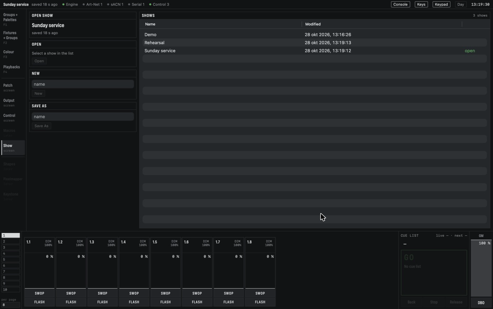

# Shows and files

A show is one file that holds everything you programmed. CMDMX saves it by itself, so there is no
Save button to forget. This section explains where shows live, how to switch between them, and how
to keep a copy or take one to another Mac.

## Where shows live

Shows are kept in `~/Documents/CMDMX/Shows/`, the *CMDMX* folder in your Documents. A show named
*Sunday service* is the file `Sunday service.cmdmx.json`. The folder is made the first time the
engine starts, and you can open it in Finder like any other folder.

A show name is 1 to 64 characters long, may not contain `/` or `:`, and may not start with a dot.
Two shows cannot have names that differ only in capitals.

When the engine starts, it opens the show that was open last. If that show is gone, it opens
*Demo*, a built-in rig for trying things out, and makes it when it does not exist.

## The Show screen

Open **Show** in the rail.

*The open show is named at the top left, with how long ago it was saved. The list on the right
holds every show in the shows folder; the open one is marked `open`.*

- **Open**: select a show in the list, then click **Open**. The button asks once more
  (`Confirm open Rehearsal — output changes now`), because the stage changes to that show. Click
  it again to open it.
- **New**: type a name and click **New**, then confirm. The new show is empty: no fixtures,
  groups or playbacks, and the default settings and outputs.
- **Save As**: type a name and click **Save As**. The show is saved under the new name and you go
  on working in the copy. Nothing on stage changes, so it does not ask.

Before you switch, the current show is saved. A name that is taken, a show that does not exist or
a show that is already open is refused with a message, and the current show keeps running.

CMDMX has no Delete or Rename. To remove a show you no longer need, delete its file in Finder
(not the one that is open).

## What a show holds

A show holds what you programmed and expect back after a restart:

- the settings (such as the number of faders per page);
- the fixture profiles it uses, so the show opens on a Mac that does not have them;
- the patch, groups and palettes;
- the playbacks, cue lists, chases and masters, and the pages with their names;
- the outputs (the Art-Net, sACN and USB nodes of the **Output** screen).

What is happening right now is not in the show and starts fresh after a restart: the fader
levels, the programmer and the selection, the Grand Master and DBO. The level of a group master is
the exception; it is saved with the show.

Your control surface mappings and OSC settings are not in the show either. They belong to the Mac
(see [Mappings](controls.md#mappings)), so a show opened on another Mac uses that Mac's surfaces.

## Autosave

A few seconds after every change to the show, the engine saves it. Moving a fader or selecting
fixtures is not a change to the show, so it does not cause a save. The status bar shows the
show's name and how long ago it was saved (`saved 4 s ago`), and the same appears on the Show
screen. Quitting the app saves the last changes too.

The engine never writes over the show file directly. It writes the new version to a file next to
it, ending in `.tmp`, and swaps that in when it is complete. So the show file is always a complete
version: the one before the change or the one after it.

- **Saving fails** (the disk is full, or the folder may not be written): the save age turns amber
  and a message says so once. The engine keeps running and tries again every few seconds. When it
  works again, a message tells you.
- **The Mac or the engine stopped during a save**: at the next start, the engine finds the `.tmp`
  file. If it is newer than the show and complete, it uses it and says that the autosave was
  recovered. Otherwise it removes it and says so.
- **A show from an older version** of CMDMX is updated when it opens. The original file is first
  copied next to it as `<name>.cmdmx.json.bak`. The same happens when something in the show could
  not be loaded (for example a fixture whose profile is broken): it is left out with a message, and
  the `.bak` keeps the file as it was.
- **A show from a newer version** is refused (`… was made by a newer CMDMX`) and not touched. Use
  the newer version of CMDMX to open it.

See also [When something goes wrong](running.md#when-something-goes-wrong).

## Backups

The shows folder is an ordinary folder, so you can back it up the way you back up anything else:
Time Machine, a copy on a USB stick, a synced folder, or a git repository. Copying a show while
CMDMX is running is safe, because the file is always complete.

The file is readable JSON, written the same way every time: saving an unchanged show gives the same
file byte for byte. In a git repository, a change shows up as a small, readable difference.

Before a show that matters, use **Save As** to keep a copy of the version that worked (for
example *Sunday service 2026-11-01*), and go on in the original.

## Moving a show to another Mac

1. In Finder, copy `<name>.cmdmx.json` from the shows folder to the same folder on the other Mac
   (`~/Documents/CMDMX/Shows/`). Make the folder if CMDMX has not run there yet.
2. Open CMDMX on the other Mac, go to **Show**, select the show and click **Open**.
3. Check the **Output** screen. Art-Net and sACN nodes come along as they were. A USB interface
   that was chosen by its port shows `port not found` until you plug it in or choose its port again
   (see [Connect output](getting-started.md#connect-output)).
4. If you use control surfaces, **Export** their mappings on the first Mac and **Import** them on
   the other one (see [Mappings](controls.md#mappings)), then tick **On** for each device.

The fixture profiles travel inside the show, so you do not need to copy them. Profiles you made
yourself are also kept per Mac, for patching new fixtures; see [Reference](reference.md#file-locations)
for where they are.

Next: [Reference](reference.md).
